# BACKLOG - 3DQM work packages

New rows enter only through the [`task-intake`](../.claude/skills/task-intake/SKILL.md) skill. Pick the lowest-numbered
`ready` row whose dependencies are `done` ([AGENTS.md §4](../AGENTS.md#4-workflow-for-one-wp)). One WP = one branch =
one session = one PR.

Statuses: `proposed` (intake done, waiting for the owner), `ready` (set by the owner only), `blocked` (reason),
`in-progress` (branch), `review` (PR or local description), `done`, `superseded` (replacing id), `dropped` (reason).
Size: S (< 1 day of agent work), M (up to ~3 days), L (larger; split when it has more than one acceptance group).
Repo: `here` = GeoIPlus/3dEditor; `shared` = GeoIPlus/shared_compnents; `geoviewer`. For `shared`/`geoviewer` rows
this is a mirror (D-23): the row in that repository is authoritative and its id is given in brackets once it exists.
Gate: the v0.3 §13 gate the row serves (G0..G5); gates are traceability only, the process is this backlog.
Type (D-221): `spec` (ADR/spec), `kernel` (kernel code), `service` (service code), `tests` (tests/fixtures), `tooling`,
`mirror` (work in another repository). Graph node icons and the legend come from Status and Type via `check-docs --fix` (D-208).
Cost: each Details entry carries `Estimate:` (set at intake, `est0` never overwritten) and, once merged, `Actual:`;
method and session data in [docs/metrics/](metrics/README.md) (D-236).

## Progress overview

Updated: 2026-11-26

| Progress | Rows |
|---|---:|
| Done | 50 / 78 |
| Review | 1 |
| In progress | 6 |
| Ready | 3 |
| Proposed (waiting for the owner to set `ready`) | 17 |
| Blocked (external access or data) | 1 |

**Implementation progress: 0 %** of code; 50/78 rows done. Planning done: agent manual and backlog (3D-00, D-48), verification
notes 3D-01 and 3D-29 ([3D-01](verification/3D-01.md), [3D-29](verification/3D-29.md)), agent tooling 3D-30 (D-47), ADR kernel package and remote port 3D-02 (D-56), repository bootstrap 3D-05 (D-59), agent evals 3D-28 (D-65, baseline 16/19 tasks hold, D-64), 3DQM spec 3D-04 ([docs/specs/3dqm-spec.md](specs/3dqm-spec.md), D-71), code-graph spike 3D-31 (D-73, result: defer), contract schemas 3D-06 ([contracts/model3d](../contracts/model3d/README.md), D-78), ADR storage 3D-03 ([3D-ADR-0003](decisions/adr/3D-ADR-0003-storage-of-versions-journal-results.md), D-87), spec update 3D-64 (D-98), latency spike and kernel ADRs 3D-08 ([3D-08 note](verification/3D-08.md): PREVIEW p95 5.4 ms / 150 ms; JS on Node, D-109..D-111, D-113), spec/AGENTS.md ADR references 3D-66 (D-143).
**Running:** 3D-15 Core edits; 3D-17 Repair ops; 3D-18 History; 3D-19 Envelope ops; 3D-71 FIT_PLANE command; 3D-47 SC: 3D view port + host.

```mermaid
flowchart TB
  subgraph done["DONE"]
    D82["✅ 📐 3D-82 Spec: 3D-69 cloud CRS (provisional)"]
    D102["✅ 🧪 3D-102 Eval rows in a reserved id range"]
    D83["✅ 📐 3D-83 ADR-0007 note: projections"]
    D101["✅ 📐 3D-101 Spec: 3D-20 installations"]
    D20["✅ ⚙️ 3D-20 Installations"]
    D89["✅ 🔧 3D-89 Growth g per row"]
    D86["✅ 🔧 3D-86 Forecast script + backfill"]
    D88["✅ 🔧 3D-88 Eval rubric false negatives"]
    D87["✅ 🔧 3D-87 Eval start states pass check-docs"]
    D85["✅ 🔧 3D-85 Cost ledger, estimates, ETC"]
    D16["✅ ⚙️ 3D-16 Ridge, eave, elevations"]
    D21["✅ ⚙️ 3D-21 Semantics, constraints cmds"]
    D84["✅ 🔧 3D-84 BACKLOG graph icons"]
    D14["✅ ⚙️ 3D-14 Replace roof, rebuild envelope"]
    D73["✅ 🔧 3D-73 backlog:sync: SC row ids"]
    D76["✅ 🔧 3D-76 check:docs: DECISIONS table integrity"]
    D77["✅ 📐 3D-77 Spec §5 solver text"]
    D81["✅ ⚙️ 3D-81 Bug: worldToLocal for all CRSs"]
    D80["✅ ⚙️ 3D-80 fitPlane order-independent"]
    D78["✅ 🔧 3D-78 Single writer + provisional ids"]
    D69["✅ ⚙️ 3D-69 Point cloud CRS vs. building CRS"]
    D11["✅ ⚙️ 3D-11 CityJSON export"]
    D70["✅ 🖥️ 3D-70 COPC-by-box points adapter"]
    D75["✅ ⚙️ 3D-75 Import state from validateModel"]
    D67["✅ 🔧 3D-67 Licence allow-list check"]
    D72["✅ 📐 3D-72 Spec: 3D-22 decisions"]
    D13["✅ ⚙️ 3D-13 Constraint solver"]
    D10["✅ ⚙️ 3D-10 CityJSON import"]
    D46["✅ 🔗 3D-46 SC: P4 canary scan"]
    D66["✅ 📐 3D-66 Apply 3D-08 ADRs to spec, AGENTS"]
    D12["✅ ⚙️ 3D-12 Validation"]
    D22["✅ ⚙️ 3D-22 Point cloud functions"]
    D32["✅ ⚙️ 3D-32 CRS support (geographic)"]
    D09["✅ ⚙️ 3D-09 B-Rep core"]
    D08["✅ 📐 3D-08 Latency spike + kernel ADRs"]
    D07["✅ 🧪 3D-07 Golden fixtures"]
    D31["✅ 🔧 3D-31 Spike: code graph / read cache"]
    D04["✅ 📐 3D-04 3DQM spec"]
    D28["✅ 🔧 3D-28 Agent evals"]
    D02["✅ 📐 3D-02 ADR kernel package and boundary"]
    D01["✅ 📐 3D-01 Verification note"]
    D29["✅ 📐 3D-29 Verify crowdsource CP/DP"]
    D27["✅ 📐 3D-27 Early ADR: contracts location + P4 canary"]
    D30["✅ 🔧 3D-30 Agent tooling"]
    D00["✅ 🔧 3D-00 Agent manual, intake, backlog"]
    D05["✅ 🔧 3D-05 Repository bootstrap"]
    D06["✅ 📐 3D-06 Contract schemas"]
    D03["✅ 📐 3D-03 ADR storage (Operaflow)"]
    D64["✅ 📐 3D-64 Spec: apply D-76, D-77"]
    D65["✅ 📐 3D-65 Schema text: D-76 in FIT_TO_SHARED_EDGE"]
  end
  subgraph review["REVIEW"]
    D45["🔍 🔗 3D-45 SC: pinned model3d schemas"]
  end
  subgraph ready["READY"]
    D74["▶️ 🖥️ 3D-74 val3dity image + binding"]
    D47["🚧 🔗 3D-47 SC: 3D view port + host"]
    D48["▶️ 🔗 3D-48 SC: apps/3dqm host"]
    D51["▶️ 🔗 3D-51 geoviewer scene3d adapter"]
  end
  subgraph g0["G0 - plan, contracts, spike (PROPOSED)"]
  end
  subgraph g1["G1 - kernel core, import, export (PROPOSED)"]
  end
  subgraph g2g4["G2..G4 - operations and cloud (PROPOSED)"]
    D15["🚧 ⚙️ 3D-15 Core edits"]
    D17["🚧 ⚙️ 3D-17 Repair ops"]
    D18["🚧 ⚙️ 3D-18 History"]
    D19["🚧 ⚙️ 3D-19 Envelope ops"]
    D100["💡 ⚙️ 3D-100 Installation size from cloud"]
    D33["💡 ⚙️ 3D-33 Inter-building validation (P1)"]
    D71["🚧 ⚙️ 3D-71 FIT_PLANE command"]
  end
  subgraph g5["G5 - service, QC, E2E (PROPOSED)"]
    D79["💡 🔧 3D-79 Service image licence check"]
    D23["💡 🖥️ 3D-23 Kernel service"]
    D68["💡 🔧 3D-68 Latency bench: COMMIT, import, concurrency"]
    D24["💡 ⚙️ 3D-24 QC and export rules"]
    D25["💡 🧪 3D-25 E2E on mock"]
  end
  subgraph client["shared / geoviewer / crowdsource mirrors (PROPOSED)"]
    D40["💡 🔗 3D-40 geo-render model3d"]
    D41["💡 🔗 3D-41 Remote kernel port"]
    D42["💡 🔗 3D-42 3DQM tools"]
    D43["💡 🔗 3D-43 plans/3dqm"]
    D44["💡 🔗 3D-44 3DQM UI panels"]
    D50["💡 🔗 3D-50 geoviewer host adapter"]
    D60["💡 🔗 3D-60 crowdsource 3D project + CityJSON"]
    D61["💡 🔗 3D-61 crowdsource COPC stream"]
    D62["💡 🔗 3D-62 crowdsource server grant"]
    D63["💡 🖥️ 3D-63 Swap to crowdsource adapters"]
  end
  subgraph blocked["BLOCKED"]
    D26["⛔ ⚙️ 3D-26 Real-data import - samples Q-07"]
  end
  D00 --> D01
  D01 --> D29
  D29 --> D03
  D03 --> D60
  D29 --> D61
  D29 --> D62
  D22 --> D63
  D23 --> D63
  D60 --> D63
  D61 --> D63
  D62 --> D63
  D01 --> D27
  D27 --> D02
  D27 --> D05
  D27 --> D06
  D05 --> D28
  D30 --> D31
  D00 --> D30
  D30 --> D05
  D01 --> D02
  D01 --> D03
  D01 --> D04
  D02 --> D04
  D00 --> D05
  D02 --> D06
  D04 --> D06
  D06 --> D07
  D04 --> D64
  D06 --> D64
  D06 --> D65
  D08 --> D66
  D05 --> D67
  D08 --> D67
  D08 --> D68
  D10 --> D68
  D15 --> D68
  D23 --> D68
  D11 --> D74
  D12 --> D74
  D23 --> D74
  D22 --> D69
  D32 --> D69
  D09 --> D81
  D32 --> D81
  D69 --> D81
  D69 --> D82
  D72 --> D82
  D69 --> D83
  D22 --> D70
  D67 --> D70
  D14 --> D71
  D22 --> D71
  D22 --> D72
  D10 --> D75
  D12 --> D75
  D23 --> D79
  D67 --> D79
  D22 --> D80
  D05 --> D08
  D06 --> D08
  D07 --> D08
  D08 --> D09
  D09 --> D10
  D87 --> D102
  D73 --> D84
  D00 --> D85
  D85 --> D86
  D86 --> D89
  D28 --> D87
  D84 --> D87
  D87 --> D85
  D87 --> D88
  D76 --> D84
  D30 --> D78
  D05 --> D78
  D13 --> D77
  D66 --> D77
  D32 --> D10
  D02 --> D32
  D06 --> D32
  D64 --> D32
  D12 --> D33
  D09 --> D12
  D10 --> D11
  D12 --> D11
  D09 --> D13
  D12 --> D14
  D13 --> D14
  D13 --> D15
  D13 --> D16
  D12 --> D17
  D13 --> D17
  D09 --> D18
  D16 --> D18
  D14 --> D19
  D12 --> D20
  D13 --> D20
  D20 --> D100
  D71 --> D100
  D20 --> D101
  D13 --> D21
  D09 --> D22
  D18 --> D23
  D06 --> D23
  D03 --> D23
  D12 --> D24
  D23 --> D24
  D24 --> D25
  D43 --> D25
  D50 --> D25
  D10 --> D26
  D11 --> D26
  D06 --> D40
  D02 --> D41
  D40 --> D42
  D41 --> D42
  D06 --> D43
  D41 --> D43
  D42 --> D44
  D06 --> D45
  D27 --> D45
  D27 --> D46
  D45 --> D40
  D45 --> D43
  D23 --> D50
  D43 --> D50
  D02 --> D47
  D47 --> D40
  D06 --> D41
  D45 --> D41
  D43 --> D48
  D47 --> D48
  D47 --> D51
  D50 --> D51
  D05 --> D73
  D46 --> D73
  D30 --> D76
  D05 --> D76
```



**Legend:** status ✅ done · 🚧 in-progress · 🔍 review · ▶️ ready · 💡 proposed · ⛔ blocked · ↪️ superseded · 🗑️ dropped. Type 📐 ADR/spec (`spec`) · ⚙️ kernel code (`kernel`) · 🖥️ service code (`service`) · 🧪 tests/fixtures (`tests`) · 🔧 tooling (`tooling`) · 🔗 mirror in another repository (`mirror`). Icons are generated by `check-docs --fix` from the row (D-208).

## Budget and forecast

Replaced by the coordinator at every merge (`merge-wp` §4a), computed by script ([method §4](metrics/README.md#4-forecast-etc-and-tuning)).

```
Forecast 2026-11-26 (ledger n=40 WPs, classes with n>=5: L kernel n=5, M kernel n=5, M tooling n=5, S spec n=8; baseline d7c472d 2026-11-19)
Known remaining: $234 / $281 over 28 rows   Overhead k=1.08   Growth g=TBD (plan period until 2026-12-03)
ETC: TBD (g not measured before 2026-12-03); known x k = $253 / $303
Throughput: 50.0 rows/week (7 d), 362 model min/week; waiting share 99 %   Accuracy: TBD (no finished WP with est0 and actual)
```

## Work-package status

| WP | Title | Repo | Modules | Depends on | Gate | Size | Type | Status |
|---|---|---|---|---|---|---|---|---|
| 3D-00 | Agent operating manual, `task-intake` and `wp-session` skills, decisions log, this backlog | here | AGENTS.md, .claude/skills, docs | - | G0 | S | tooling | done (D-48) |
| 3D-01 | Verification note: HANDOVER §5-§7 and v0.3 §2 checked against code (shared_compnents = Tools Plane, geoviewer, Operaflow = CP + DP) | here | docs/verification | 00 | G0 | S | spec | done (D-34; merged into base, no PR) |
| 3D-02 | ADR: `geo-model3d` package - internal layout, remote kernel port, relation to `geo-render`/`workspace` (contracts location and P4 check moved to 3D-27) | here | docs/decisions | 01, 27 | G0 | M | spec | done (D-56; merged into base, no PR; [3D-ADR-0002](decisions/adr/3D-ADR-0002-kernel-package-and-remote-port.md), D-51..D-55) |
| 3D-03 | ADR: storage of building versions, edit journal and results | here | docs/decisions | 01, 29 | G0 | M | spec | done (D-87; merged into base, no PR; [3D-ADR-0003](decisions/adr/3D-ADR-0003-storage-of-versions-journal-results.md) accepted D-85, D-82..D-84) |
| 3D-04 | Spec `docs/specs/3dqm-spec.md`: v0.3 in module form, C.8/C.11 in plane terms, golden tests mapped to modules | here | docs/specs | 01, 02 | G0 | L | spec | done (D-71; merged into base, no PR) |
| 3D-05 | Repository bootstrap: npm workspace, Vitest, `tsc --checkJs`, `check:arch` (300 lines, P4 canary + negative control per 3D-ADR-0001), `check:docs`, `backlog:sync`, CI | here | root, tools | 00, 27 | G0 | M | tooling | done (D-59; merged into base, no PR) |
| 3D-06 | Contract schemas `model3d`: model, commands (all `OperationKind`), patch, lineage, validation report, error registry, tolerance profile | here (D-37) | contracts | 04, 27 | G0 | L | spec | done (D-78; merged into base, no PR; schemas [contracts/model3d](../contracts/model3d/README.md), D-75..D-77) |
| 3D-07 | Golden fixtures: format and synthetic CityJSON/point sets for GT-I1..GT-25 | here | fixtures | 06 | G0 | M | tests | done (D-103; merged into base, no PR; [fixtures](../fixtures/README.md)) |
| 3D-08 | Latency spike: prototype `MOVE_EDGE` on GT-03, p95; ADRs kernel language/Boolean (ADR-001), solver (ADR-S), bench rig (ADR-012) | here | geo-model3d (spike), docs | 05, 06, 07 | G0 | M | spec | done (D-113; merged into base, no PR; [note](verification/3D-08.md): p95 5.4 ms / 150 ms; 3D-ADR-0004..0006 accepted D-109..D-111) |
| 3D-09 | Kernel core: half-edge B-Rep, primary planes, derived vertices, local frame, transactions, versions | here | geo-model3d/brep | 08 | G1 | L | kernel | done (D-120; merged into base, no PR) |
| 3D-10 | Import I-01: CityJSON -> canonical model + RTG + baseline | here | geo-model3d/import | 09, 32 | G1 | L | kernel | done (D-158; merged into base, no PR) |
| 3D-11 | Export: canonical model -> CityJSON, opaque data round-trip | here | geo-model3d/export | 10, 12 | G1 | M | kernel | done (D-194; merged into base, no PR; D-189..D-193) |
| 3D-12 | Validation: FAST_PREVIEW, COMMIT_VALIDATION, FINAL_VALIDATION (val3dity), severity by state | here | geo-model3d/validate | 09 | G1 | L | kernel | done (D-154; merged into base, no PR; [3D-ADR-0008](decisions/adr/3D-ADR-0008-val3dity-binding.md) accepted D-161) |
| 3D-13 | Constraint solver and conflict diagnostics | here | geo-model3d/solve | 09 | G3 | L | kernel | done (D-174; merged into base, no PR) |
| 3D-14 | `REPLACE_ROOF` R-01..R-04, `REBUILD_ENVELOPE` | here | geo-model3d/ops | 12, 13 | G2 | L | kernel | done (D-219; merged into base, no PR; D-212..D-218) |
| 3D-15 | Core edits: `MOVE_VERTEX`, `MOVE_EDGE`, `OFFSET_FACE`, `SPLIT_FACE`, `INSERT_ROOF_BREAK`, `MERGE_FACES`, `REMOVE_DETAILS`, `STRAIGHTEN_FACE`, `TRIM_FACE`, `EXTEND_FACE` | here | geo-model3d/ops | 13 | G3 | L | kernel | in-progress (D-220; wp/3d-15-core-edits) |
| 3D-16 | `ALIGN_RIDGE`, `ALIGN_EAVE`, `MATCH_ELEVATIONS` | here | geo-model3d/ops | 13 | G3 | M | kernel | done (D-235; merged into base, no PR; D-231..D-234) |
| 3D-17 | Repair: `REMOVE_FACE`, `HEAL_HOLE`, `FIT_TO_SHARED_EDGE`, `ALIGN_JUNCTION` | here | geo-model3d/ops | 12, 13 | G3/G4 | L | kernel | in-progress (D-220; wp/3d-17-repair) |
| 3D-18 | History: `UNDO`, `REDO`, `RESTORE_BASELINE` (idempotent `commandId`, `expectedVersion` moved to 3D-23, D-68) | here | geo-model3d | 09, 16 | G3 | M | kernel | in-progress (D-267; wp/3d-18-history) |
| 3D-19 | Envelope: `RESIZE_ROOF`, `SET_OVERHANG`, `REGULARIZE_FOOTPRINT`, `ALIGN_WALL`, `SET_HEIGHT`, `TRANSLATE_BUILDING`, `ROTATE_BUILDING` | here | geo-model3d/ops | 14 | G4 | L | kernel | in-progress (D-267; wp/3d-19-envelope-ops) |
| 3D-20 | Installations: `ADD_DORMER`, `ADD_CHIMNEY`, `REMOVE_INSTALLATION`; limited Boolean (v0.3 §14, K-12) | here | geo-model3d/ops | 12, 13 | G4 | L | kernel | done (D-263; merged into base, no PR; D-256..D-262) |
| 3D-100 | Installation size from the cloud: `measurementId` of `ADD_CHIMNEY` / `ADD_DORMER` (v0.3 §6 F-36, F-37) | here | geo-model3d/ops | 20, 71 | G4 | M | kernel | proposed |
| 3D-101 | Spec update for 3D-20: §10.11 dimensions, `ridgeRiseM`, refusal codes, roof not cut; §14 Q-38 closed (D-256..D-260) | here | docs/specs | 20 | G4 | S | spec | done (D-272; merged into base, no PR) |
| 3D-102 | Agent-eval scenarios use a reserved row id range (e.g. 3D-9xx) that the real backlog never reaches, instead of 3D-90..3D-98 (D-264) | here | docs/agent-evals, tools/agent-evals | 28, 87 | G0 | S | tests | done (D-277; merged into base, no PR) |
| 3D-21 | `SET_SEMANTICS`, `SET_CONSTRAINT`, `REMOVE_CONSTRAINT` | here | geo-model3d/ops | 13 | G3 | S | kernel | done (D-230; merged into base, no PR; D-226..D-229) |
| 3D-22 | Point cloud: point port (box query) with interim adapter reading COPC by box / LAS whole (D-35), `FIT_PLANE` (RANSAC + SVD), deviation heatmap | here | geo-model3d/cloud | 09 | G4 | M | kernel | done (D-137; merged into base, no PR) |
| 3D-23 | Kernel service: command API PREVIEW/COMMIT/`previewId`, idempotent `commandId` + `expectedVersion` (GT-13, D-68), rate limit, error registry, command status, storage port with interim file/S3 adapter (D-35) | here | service | 03, 06, 18 | G5 | L | service | proposed |
| 3D-24 | QC and export rules: state transitions, approver != author (enforced by 3DQM: the Operaflow format has no separation-of-duties rule), reset on edit, export gate, batch export report | here | geo-model3d, service | 12, 23 | G5 | M | kernel | proposed |
| 3D-25 | E2E on CP/DP mock: import -> edit -> validate -> approve -> export -> re-import | here | e2e | 24, 43, 50 | G5 | M | tests | proposed |
| 3D-26 | Import acceptance on real roofer and TerraSolid output; tolerance profile calibration | here | geo-model3d/import, fixtures | 10, 11 | G1 | M | kernel | blocked (sample data path, Q-07) |
| 3D-27 | Early ADR: location of `model3d` contract schemas (Q-08) and P4 canary check of client bundles (Q-09) | here | docs/decisions | 01 | G0 | S | spec | done (D-39; merged into base, no PR) |
| 3D-29 | Verify `GeoIPlus/crowdsource` as the CP/DP implementation: data serving, storage, versions, point-cloud forms, auth, deployment | here | docs/verification | 01 | G0 | S | spec | done (D-36; merged into base, no PR) |
| 3D-30 | Agent tooling: `merge-wp` skill, `tools/check-docs.mjs` + Stop hook, `docs/source` edit guard, read-only permission allow list | here | .claude, tools | 00 | G0 | S | tooling | done (D-47; merged into base, no PR) |
| 3D-28 | Agent evals: 6-8 golden agent tasks + one per hard rule, rubric, runner, two runs each, baseline in DECISIONS | here | docs/agent-evals | 05 | G0 | M | tooling | done (D-65; merged into base, no PR) |
| 3D-31 | Spike: codebase graph / read-cache tool (MCP or skill) measured on cross-repo reading tasks, with vs. without | here | .claude, docs/agent-evals | 30 | G0 | M | tooling | done (D-73; merged into base, no PR; result: defer, [eval](agent-evals/3D-31-code-graph.md)) |
| 3D-60 | crowdsource: 3D project type and CityJSON building dataset kind (Operaflow-conformant) | crowdsource | backend, streaming | 03, 29 | G5+ | L | mirror | proposed (D-35; under crowdsource's own process) |
| 3D-61 | crowdsource: point clouds as COPC `stream` datasets (box reads by the client of the stream) | crowdsource | streaming | 29 | G5+ | M | mirror | proposed (D-35) |
| 3D-62 | crowdsource: client-credentials (server-to-server) grant for supporting-application services | crowdsource | backend, auth | 29 | G5+ | M | mirror | proposed (D-35) |
| 3D-63 | Swap 3DQM interim `datasets` adapters for crowdsource datasets; migrate stored input buildings (the `history` store stays own, D-82) | here | service, geo-model3d/cloud | 22, 23, 60, 61, 62 | G5+ | M | service | proposed (D-35) |
| 3D-64 | Spec update: apply D-76 (Q-20 refusal codes) and D-77 (Q-21 severities) to `docs/specs/3dqm-spec.md`; list contract questions Q-26..Q-39 | here | docs/specs | 04, 06 | G0 | S | spec | done (D-98; merged into base, no PR) |
| 3D-32 | CRS support: server-only transform module, local metric frame (ENU) per building, ADR for the library; spec and schema update for geographic CRSs (D-92) | here | geo-model3d (frame), services/kernel, docs, contracts | 02, 06, 64 | G1 | M | kernel | done (D-127; merged into base, no PR; [3D-ADR-0007](decisions/adr/3D-ADR-0007-crs-transform.md); EPSG terms Q-43 open) |
| 3D-33 | Inter-building validation (shared walls, overlaps between buildings), P1 (D-89) | here | geo-model3d/validate | 12 | P1 | M | kernel | proposed |
| 3D-65 | Schema text: `FIT_TO_SHARED_EDGE` `maxDisplacementM` description cites D-76 instead of open Q-20 / "3D-06 proposes" | here | contracts | 06 | G0 | S | spec | done (D-107; merged into base, no PR) |
| 3D-66 | Apply accepted 3D-08 ADRs to spec and AGENTS.md: spec §1.3, §5 r8, §10.4 r5, §11 r14; AGENTS.md §2 rule 8 cites 3D-ADR-0004 | here | docs | 08 | G0 | S | spec | done (D-143; merged into base, no PR) |
| 3D-67 | Licence allow-list check in `check:arch`: kernel and service runtime dependencies permissive only (3D-ADR-0004 decision 3) | here | tools/check-arch | 05, 08 | G1 | S | tooling | done (D-182; merged into base, no PR) |
| 3D-68 | Latency bench beyond PREVIEW: COMMIT of a simple operation, import up to 500 faces, PREVIEW under concurrent requests (v0.3 §11) | here | tools/bench | 08, 10, 15, 23 | G5 | M | tooling | proposed (D-112) |
| 3D-69 | Point cloud CRS vs. a geographic-CRS building: reproject points into the building metric frame on the server, or refuse a mismatch (D-126) | here | geo-model3d/cloud, services/kernel | 22, 32 | G4 | M | kernel | done (D-199; merged into base, no PR) |
| 3D-70 | COPC-by-box points adapter: LAZ decoder `laz-perf` (Apache-2.0) behind the points port, with an ADR for the new runtime dependency (D-109, D-133) | here | services/kernel | 22, 67 | G4 | M | service | done (D-188; merged into base, no PR; [3D-ADR-0009](decisions/adr/3D-ADR-0009-copc-laz-decoder.md)) |
| 3D-80 | `fitPlane` result independent of the input point order (same cloud through the LAS or COPC adapter gives the same `FIT_PLANE` result) | here | geo-model3d/cloud | 22 | G4 | S | kernel | done (D-203; merged into base, no PR) |
| 3D-71 | `FIT_PLANE` command: apply the plane fit as a `PLANE` measurement or as a face's new `supportPlane` through PREVIEW/COMMIT (spec §10.12 r4, D-134) | here | geo-model3d/ops | 14, 22 | G4 | M | kernel | in-progress (D-267; wp/3d-71-fit-plane) |
| 3D-72 | Spec update for 3D-22 decisions: `heatmap-request` and `PointSelection` in §2, §9 r3/r6 (D-130, D-131, D-135), §10.12 r4 selection (D-132) | here | docs/specs | 22 | G4 | S | spec | done (D-176; merged into base, no PR) |
| 3D-73 | `backlog:sync` links mirror rows to `shared_compnents`: accept SC's bare-number row ids (`76`), vendor the first SC pin (D-57), link 3D-46 as `shared (76)` | here | tools | 05, 46 | G0 | S | tooling | done (D-210; merged into base, no PR) |
| 3D-74 | val3dity binding: own pinned container image (val3dity 2.7.0, GPL-3.0 isolated) and the `services/kernel` adapter of the `validate` external-validator port (D-148, D-149) | here | services/kernel, val3dity image, contracts | 11, 12, 23 | G5 | M | service | ready (D-155) |
| 3D-75 | Import state from `validateModel`: replace the interim `import/state.js` (D-157) | here | geo-model3d (index, import, validate) | 10, 12 | G1 | S | kernel | done (D-185; merged into base, no PR) |
| 3D-76 | `check:docs`: DECISIONS.md table integrity - a `D-NN` / `Q-NN` row in "Open-question status updates" must have the status-row shape and name an existing id; a decision row outside "## Decisions" is a problem (D-167) | here | tools | 30, 05 | G0 | S | tooling | done (D-209; merged into base, no PR) |
| 3D-77 | Spec §5 text for the solver decisions: per-kind constraint table (D-169) and D-170..D-172 | here | docs/specs | 13, 66 | G3 | S | spec | done (D-206; merged into base, no PR) |
| 3D-78 | Single writer and provisional ids: push guard hook, `check:docs` provisional-id rule for rows and ADRs, generated BACKLOG overview, skills `merge-wp` / `wp-session` / `task-intake` and AGENTS.md §3/§6 updated (D-178..D-180) | here | tools, .claude, AGENTS.md | 30, 05 | G0 | M | tooling | done (D-202; merged into base, no PR) |
| 3D-79 | Service image licence check: no GPL, LGPL or AGPL in the kernel service container image (3D-ADR-0004 decision 3, D-181) | here | service image, tools/check-arch | 23, 67 | G5 | M | tooling | proposed |
| 3D-81 | Bug: public `worldToLocal` / `localToWorld` use a plain translation; wrong for geographic and north-first projected buildings (found by 3D-69) | here | geo-model3d (index) | 09, 32, 69 | G1 | S | kernel | done (D-205; merged into base, no PR) |
| 3D-82 | Spec update for 3D-69: §4a cloud reprojection (`createCrsMapping`, `DATUM_MISMATCH` / `NO_PROJECTION`), §9 cloud CRS from the dataset descriptor (D-164, D-165, D-196..D-198) | here | docs/specs | 69, 72 | G4 | S | spec | done (D-279; merged into base, no PR) |
| 3D-83 | 3D-ADR-0007 note: the CRS table also holds PROJ proj-strings of projected CRSs, verified against PROJ (D-198); needs owner approval (D-18) | here | docs/decisions/adr | 69 | G4 | S | spec | done (D-274; merged into base, no PR) |
| 3D-84 | BACKLOG graph icons: status and work-type icon per WP node, generated by `check-docs --fix` (D-208) | here | tools, docs | 73, 76 | G0 | M | tooling | done (D-224; merged into base, no PR) |
| 3D-85 | Session cost ledger, per-row estimates, backlog forecast (ETC) and independent efficiency review: rules in AGENTS.md §7.7/§7.9 and the skills (D-236..D-240) | here | AGENTS.md, .claude/skills, docs/metrics, docs/templates | 00 | G0 | S | tooling | done (D-244; merged into base, no PR) |
| 3D-87 | Bug: agent-eval start states fail `check:docs` - scenario rows lack the `Type` cell (D-221) and documents link into the paths hidden from the agent | here | tools/agent-evals, docs/agent-evals | 28, 84 | G0 | S | tooling | done (D-244; merged into base, no PR) |
| 3D-88 | Bug: two eval rubrics give false negatives - `js-esm-jsdoc` `esm-jsdoc` (re-export-only file needs `@param`) and `never-push-main` `names-rule` (misses "not to `main`") | here | docs/agent-evals, tools/agent-evals | 28, 00.3 | G0 | S | tooling | done (D-247; merged into base, no PR) |
| 3D-86 | Forecast script `tools/budget.mjs` (ledger + BACKLOG -> ETC block) and ledger backfill of every finished WP session | here | tools, docs/metrics | 85 | G0 | S | tooling | done (D-248; merged into base, no PR) |
| 3D-89 | Forecast growth g from per-row first appearance: rows dated by the commit where they first appear, the plan baseline (first 14 days of the backlog) excluded; baseline commit printed, shallow clone refused (D-250) | here | tools, docs/metrics | 86 | G0 | S | tooling | done (D-255; merged into base, no PR) |
| 3D-40 | `geo-render/model3d`: draw edited building from patches against the 3D view port, hide source layer, ghost, pick by entity id | shared | geo-render | 06, 45, 47; shared WP-19, WP-20 | G3 | L | mirror | proposed (Q-16 closed by D-54: 3D host split out to 3D-47; UI per brandbook, D-40) |
| 3D-41 | Remote kernel port: `model3d-kernel` registry service adapter, host-injected transport, Tools Plane placement value in plan v2 | shared | plans/registry, workspace, contracts | 02, 06, 45; shared WP-28 | G3 | M | mirror | proposed (Q-13 closed by D-52, D-53) |
| 3D-42 | 3DQM tools: E-04 state machine, selection, snapping incl. point cloud, numeric input, PREVIEW throttling | shared | workspace/tools | 40, 41; shared WP-24 | G3 | L | mirror | proposed (UI per brandbook, D-40) |
| 3D-43 | `plans/3dqm`: `production` and `qa` plans, 3DQM contract extension schema | shared | plans, contracts | 06, 41, 45; shared WP-21, WP-28 | G5 | M | mirror | proposed (Q-03 shape known, 3D-01 §6; extension URI content-named, no product) |
| 3D-44 | 3DQM UI panels: validation issues, constraint inspector, heatmap legend, QC approve/return | shared | workspace/ui | 42; shared WP-23, WP-25 | G4/G5 | M | mirror | proposed (UI per brandbook, D-40) |
| 3D-45 | Pinned `model3d` schemas in `shared_compnents`: `contracts/vendor/3deditor/` + `provenance.json` hash check; how client code loads them | shared (77) | contracts | 06, 27 | G3 | S | mirror | review (D-270; bookkeeping merged here; SC row 77 waits for PR #68) |
| 3D-47 | `geo-render` 3D view port and perspective host (camera, controls, point drawing); SC ADR first | shared | geo-render | 02; shared WP-19 | G3 | L | mirror | in-progress (D-61; SC wp/70-3d-view-host, wp/71-3d-camera-controls; started in a fresh cloud session; UI per brandbook, D-40) |
| 3D-48 | `apps/3dqm`: independent 3DQM host that assembles the workplace from the CP document | shared | apps | 43, 47; shared WP-28 | G5 | M | mirror | ready (D-61; waits for 3D-43, 3D-47, SC WP-28; D-55; UI per brandbook, D-40) |
| 3D-46 | P4 canary scan of `shared_compnents` browser outputs + rule "no `geo-model3d` dependency" | shared (76) | tools, CI | 27 | G0 | S | mirror | done (D-147; merged into base, no PR here; code: SC row 76 `done`, [SC pull request #67](https://github.com/GeoIPlus/shared_compnents/pull/67) merged `b65c139`; D-144, D-145) |
| 3D-50 | geoviewer host adapter: add `@geoiplus/*` dependencies (none today), mount workplace, kernel route on server (mounts `createKernelHandler`, 3D-ADR-0002), file storage port for tests, P4 canary scan of the client build | geoviewer | host | 23, 43 | G5 | M | mirror | proposed (UI per brandbook, D-40) |
| 3D-51 | geoviewer `scene3d` adapter implementing the 3D view port (entity-id pick, model3d drawing in GV) | geoviewer | scene3d | 47, 50 | G5 | M | mirror | ready (D-61; waits for 3D-47, 3D-50; D-54; UI per brandbook, D-40) |

## Details

### 3D-00 Agent operating manual and backlog
- Source: owner message 2026-11-19. Goal: rules for agent sessions, documentation, handoffs and intake.
- Accept: AGENTS.md, CLAUDE.md, STRUCTURE.md, skills `task-intake` and `wp-session`, templates, DECISIONS.md with
  D-01..D-27 and Q-01..Q-13, this backlog; owner questions asked as dialog and recorded.

### 3D-01 Verification note
- Goal: each [V]/[A] item of HANDOVER §5-§7 and v0.3 §2 checked against code with file references; corrections listed.
- Accept: `docs/verification/3D-01.md`; every item marked confirmed / corrected / not checkable (why); Q-12, Q-13
  answered or narrowed; how geoviewer consumes `@geoiplus/*` recorded; Operaflow (CP, D-29): workplace contract
  shape, assignment/roles, data/storage and point-cloud access (narrows Q-02..Q-05); list of Operaflow conformance
  requirements for the kernel service (Q-15, D-31). Read-only in other repositories.

### 3D-02 ADR kernel package and boundary
- Accept: `3D-ADR-0002` answers Q-13 and HANDOVER §7 Q2 (remote port), the internal package layout and the relation
  to `geo-render`/`workspace`, with options and a recommendation; owner-approved (D-18). Builds on 3D-27.

### 3D-03 ADR storage
- Accept: `3D-ADR-0003` proposes one option for versions, journal, baseline and results after reading CP/DP code;
  retention >= 90 days (v0.3 §11) addressed; conforms to Operaflow (D-31, Q-15).
- 3D-01 input: Operaflow holds no storage. Dataset `version`, `PUT` + `If-Match` / OGC API Features saves and immutable
  deliveries are in the format; the journal, drafts and retention are 3DQM's own ([verification §9](verification/3D-01.md#9-operaflow-as-cp--dp-data-point-clouds-conformance-d-30-d-31-q-15)).
- Result: [3D-ADR-0003](decisions/adr/3D-ADR-0003-storage-of-versions-journal-results.md): append-only object store (S3 / file) with conditional writes; ports `history` (own for good, D-82)
  and `datasets` (swapped in 3D-63); one `progress.save` dataset per building (D-83, input to 3D-43, 3D-60); nothing
  deleted (D-84). Open for 3D-24: Q-40.

### 3D-04 3DQM spec
- Accept: one section per module (purpose, API, rules, `Accept:` lines); contracts as a list of schemas; C.8 and C.11
  restated in plane terms (D-08); each golden test of v0.3 §12 assigned to one module and one row; v0.3 process text
  (gates, agent template) dropped; admin functions removed (D-10). Owner reviews before 3D-06 starts.

### 3D-05 Repository bootstrap
- Accept: `npm ci && npm run check` pass on the empty skeleton; a planted client-side import of `geo-model3d`, a 301-line
  file, a DOM global in the kernel and the P4 canary planted in a test bundle each fail `check:arch` (tests for the
  checker). Per [3D-ADR-0001](decisions/adr/3D-ADR-0001-contracts-location-and-p4-canary.md) (D-37): the canary value
  is generated once; `check:arch` fails if an `exports` entry of `geo-model3d` does not import the canary module; the
  negative control (minified Vite browser build of each entry) finds the marker in every output, else CI fails. `check:docs` fails on a planted count mismatch, a graph node without a row, a duplicate D/Q id, a dead link
  and a row without `Accept:`. `backlog:sync` reads a pinned ref of the other BACKLOG (fixture in tests, no network)
  and CI fails on drift (D-25). `check:docs` also rejects provisional decision ids `D-3D<wp>-<n>` on the base (D-38). Commands of AGENTS.md §5 exist.

### 3D-06 Contract schemas
- Accept: JSON Schema 2020-12 for every `OperationKind` payload (v0.3 §9.1), result, patch, `topologyLineage`
  `{mapped, deleted, preserved}`, validation report, error registry (v0.3 §9.2), tolerance profile (D-13 values as
  defaults); valid and invalid examples per schema; Ajv 2020 compiles all. Owner-approved (D-18). Location
  `contracts/model3d/` here; every `$id` matches `urn:geoiplus:schema:model3d-<name>:v<n>` (D-37, 3D-ADR-0001). L: split by intake if
  the command schemas and the model schemas review separately.

### 3D-07 Golden fixtures
- Accept: fixture format recorded; inputs for GT-I1..GT-I4, GT-01..GT-25 generated by a script, byte-identical on
  regeneration; expected values copied from v0.3 §12 with the checks of its last paragraph reproduced in a test.

### 3D-08 Latency spike and kernel ADRs
- Accept: prototype `MOVE_EDGE` on GT-03 in the chosen language; p95 server PREVIEW for a 200-face building measured on
  the recorded rig; result vs. 150 ms target. If it fails: escalate to the owner (D-06), no client fallback. ADRs for
  kernel language/Boolean library and licences (closes Q-01) and solver approach, owner-approved.

### 3D-09 .. 3D-24 Kernel, operations, service
- 3D-02 changes (`change-wp`, [3D-ADR-0002](decisions/adr/3D-ADR-0002-kernel-package-and-remote-port.md), D-51):
  3D-09 Accept adds: `check:arch` enforces the module DAG of the ADR (C1 rule 2), no I/O in `geo-model3d` (no `fs`/`net`/
  `http(s)`/`child_process`/`process.env`, no `Date.now`/`Math.random`), only `services/kernel` imports it.
  3D-23 Accept adds: `services/kernel` exports `createKernelHandler(ports)` (plain Node, mountable by geoviewer, 3D-50) and
  its own server for the image (D-33); every request and reply validates against `contracts/model3d/`.
- 3D-08 changes (`change-wp`, D-111, Q-42): 3D-23 Accept adds: `npm run bench` gate re-run on the production
  instance class of the service image; numbers and fingerprint recorded; a miss is an owner escalation (D-06).
- Accept lines come from `docs/specs/3dqm-spec.md` (3D-04). Golden tests per row:
  3D-09 GT-25; 3D-10 GT-I1..GT-I3; 3D-11 GT-I4; 3D-14 GT-01..GT-05; 3D-15 GT-08, GT-10; 3D-16 GT-07, GT-09;
  3D-17 GT-06, GT-11, GT-19; 3D-18 GT-12; 3D-19 GT-14..GT-16; 3D-20 GT-17, GT-18; 3D-22 GT-20, GT-21;
  3D-23 GT-13 (D-68); 3D-24 GT-22, GT-24 (GT-23 is enforced from the CP contract, D-10: test belongs to 3D-25).
- Every operation: atomic commit, PREVIEW before COMMIT, hard-constraint conflict -> refusal without partial change,
  lineage in the result, "commit adds no new errors for the current state" (v0.3 §6).

### 3D-25 E2E
- Accept: the v0.3 G5 E2E chain on the CP/DP mock in both workplaces; GT-23 (building outside assignment -> 403).

### 3D-26 Real-data import
- Accept: import + export round-trip of the owner's roofer and TerraSolid samples; tolerance profile adjustments
  proposed as decisions, not edited silently. Binaries stay outside git unless the owner allows.

### 3D-27 Early ADR: contracts location and P4 canary
- Source: owner dialog 2026-11-19 (D-24). Goal: close the repository seam before contracts and bootstrap start.
- Accept: `3D-ADR-0001` closes Q-08 (one authoritative location of `model3d` schemas, how the other repository
  consumes them at a pinned version) and Q-09 (canary marker format, which bundles CI scans in each repository);
  owner-approved (D-18). Reads `shared_compnents` contracts/build setup; read-only there.

### 3D-29 Verify crowdsource as CP/DP implementation
- Source: owner dialog 2026-11-19 (D-32). Goal: replace the assumption "Operaflow = DP" by facts.
- Accept: `docs/verification/3D-29.md` with `crowdsource` revision and file:line references: what CP/DP roles it
  implements, how it serves datasets (forms, `stream`/COPC, box reads), where versions/results/journals live, auth,
  deployment; Q-02, Q-05, Q-14 narrowed; D-32 confirmed or corrected. Read-only in `crowdsource`.

### 3D-30 Agent tooling (D-46)
- Source: claude-code-setup analysis, owner dialog 2026-11-19. Goal: cut repeated coordinator work and ad-hoc checks.
- Accept: (1) `.claude/skills/merge-wp/SKILL.md`: ancestry check, merge, provisional ids `D-3D<wp>-n` -> final `D-NN`
  with all references rewritten, backlog recount, branch delete attempt, session archive (D-38, D-42).
  (2) `tools/check-docs.mjs` (Node, no deps): overview counts = table, mermaid nodes = rows, unique D/Q ids in the
  decision table, no provisional ids, relative links resolve, every row has an Accept line or a Details entry; exit 1
  with one line per problem; tests on planted faults in `tools/check-docs.test.mjs` runnable with `node --test`.
  (3) `.claude/settings.json`: Stop hook runs the script only when `docs/` changed (quiet on success); PreToolUse hook
  refuses Edit/Write under `docs/source/`; allow list for read-only git/grep. (4) Each hook demonstrated once with output.
  3D-05 later folds the script into `npm run check`.

### 3D-28 Agent evals
- Source: owner dialog 2026-11-19 (D-27). Goal: prove the instructions by measurement.
- Accept: `docs/agent-evals/<task>/` with prompt, start state, rubric graded on the final result; tasks at least:
  intake of a new request, chore vs. non-chore, refuse a client import of the kernel, mark an unknown tolerance
  `TBD`, refuse to re-open a decision, handoff to a fresh session, question asked as a dialog; plus one per hard rule
  of AGENTS.md §2. Every task run twice; scores recorded in DECISIONS.md. A rule change is kept only if evals hold.

### 3D-31 Spike: codebase graph / read-cache tool (D-50)
- Source: owner message 2026-11-19 (Codebase Memory MCP and similar graph/cache tools against repeated code reading).
- Goal: decide with measured data whether one local code-graph or read-cache tool lowers cost per task without lowering
  result quality.
- Scope in: check which candidate tools exist and what they need (codebase-memory-mcp first; others only if their
  repository is found); pick one that runs fully locally (no code sent to external services); install it for the
  session only; one fixed cross-repo reading task on code that exists (`GeoIPlus/shared_compnents` and/or `geoviewer`,
  e.g. "where would the remote kernel port plug in, what does it touch"), run twice with and twice without the tool.
  Scope out: permanent install in `.claude/settings.json` or the environment setup script (needs a new owner decision),
  indexing `docs/source` (markdown, not code), more than one tool per run.
- Accept: `docs/agent-evals/3D-31-code-graph.md` with tool name, version, install steps actually run, the task text,
  a rubric, and per run: cost, context tokens, tool calls, turns, rubric score; tool-definition count added; a
  recommendation (adopt / defer until kernel code exists / reject) that follows from the numbers; noise stated
  (n=2 per arm). Vendor claims are cited as claims, not results.
- Decisions: D-43, D-50  Open: -

### 3D-32 CRS support (D-92, D-93)
- Source: owner dialog 2026-11-23 (Q-11, v0.3 Д-04 changed). Goal: import, edit and export buildings in geographic CRSs
  without losing the exact round trip.
- Scope in: ADR for the transform library (server-only, licence, version pin; P4: nothing in a browser bundle); a module
  that maps a building to a local metric ENU frame and back; export converts back only vertices changed by an edit,
  untouched vertices keep their file coordinates (D-70); spec import/export rules and `INVALID_CRS` wording updated
  (after 3D-64), and every `Q-11` marker in the spec replaced by D-88..D-94; schema change only if a field is needed
  (owner approval, D-18). Scope out: vertical datum transforms
  (D-93: heights as in the file), point cloud reprojection.
- Accept: round trip of a geographic-CRS fixture with no edits is exact (GT-I4 rule, 0.001 m); an edited building
  re-exports with changed vertices within the tolerance profile; a projected-CRS file takes the same path unchanged;
  unknown CRS -> `INVALID_CRS`; `check:arch` shows the module unreachable from client bundles.
- Decisions: D-04, D-06, D-07, D-70, D-88..D-94  Open: -

### 3D-33 Inter-building validation, P1 (D-89)
- Source: owner dialog 2026-11-23 (Q-11, v0.3 Д-05). Goal: find shared-wall gaps and overlaps between adjacent buildings.
- Accept: TBD when P1 is planned (spec section and golden tests to be written first).
- Decisions: D-89  Open: -

### 3D-77 Spec §5 solver text (D-173)
- Source: 3D-13 session 2026-11-24 (D-173). Goal: the spec states what the solver implements.
- Scope in: spec §5 gets the per-kind constraint table (from the `solve` module card, D-169), the check tolerances
  (D-170), the `missingDegreesOfFreedom` format (D-171) and the underconstrained threshold (D-172). Scope out: code.
- Accept: spec §5 cites D-169..D-172 and matches the module card; `node tools/check-docs.mjs` passes.
- Decisions: D-169..D-173  Open: -

### 3D-78 Single writer and provisional ids (D-178..D-180)
- Source: owner dialog 2026-11-24, after repeated id clashes of parallel sessions (D-141, D-167, D-168, 3D-66, 3D-ADR-0004).
- Scope in: (1) hook (PreToolUse on Bash `git push`) refusing a push to the base branch unless the session is the
  coordinator (marker named in the checkpoint of 3D-00); (2) `check:docs`: on a WP branch, new `D-NN`, `Q-NN`, `3D-NN`
  rows and `3D-ADR-NNNN` files not in the base are problems; provisional forms `3D-<wp>.n` and `3D-ADR-<wp>-n` accepted;
  (3) `check-docs --fix` regenerates overview counts and the `Running:` line, `Updated:` becomes a date; (4) `merge-wp`
  maps provisional rows and ADRs too; `wp-session` and `task-intake` say "hand over, never write the base"; AGENTS.md
  §3/§6 one-line changes (owner approves the exact diff, AGENTS.md §10).
- Accept: a planted push to the base from a WP session is refused; a planted final id on a WP branch fails `check:docs`;
  `--fix` makes a hand-broken count pass; `node --test tools/check-docs.test.mjs` and `npm run check` pass.
- Decisions: D-38, D-178..D-180, D-174  Open: -

### 3D-85 Session cost ledger, estimates, forecast and efficiency review
- Source: owner message 2026-11-25 ("each session records its token cost and analyses its performance, optionally with
  an independent agent (Fable); the coordinator puts estimated time and tokens per task into the backlog to see
  velocity and ETC of the whole backlog; goal: predictability and a budget that is tuned continuously").
- Goal: every session's cost is measured and every row has an estimate, so the backlog has a forecast that improves
  with each finished WP.
- Scope in: AGENTS.md §6, §7.7, §7.9, §9; skills `wp-session`, `merge-wp`, `task-intake`; checkpoint template;
  `docs/metrics/README.md` (method), `docs/metrics/LEDGER.md` (data); this section "Budget and forecast".
  Scope out: the forecast script and the backfill (3D-86); the daily-report prompt (D-44) - separate change.
- Accept: after the eval-harness fix (3D-87), one eval run of this change (19 x 2) keeps every task that held in the D-64
  baseline (16/19) holding, or each flip is explained (D-239, D-240); `node tools/check-docs.mjs` passes.
- Result: eval run 2026-11-25 - 16/19 hold as in the baseline, every flip explained, none caused by this change (D-242).
- Decisions: D-43, D-44, D-64, D-236..D-242  Open: -
- Estimate: prior (no data)

### 3D-87 Bug: agent-eval start states fail check:docs
- Source: 3D-85 session, 2026-11-25 (`node tools/agent-evals/cli.mjs --dry`); introduced by 3D-84 (Type column) and by
  links to eval results added after 3D-28.
- Goal: every eval start state passes `check:docs`, so an eval run measures the agent, not a broken scenario.
- Scope in: `scenario.mjs` `addRow` writes the `Type` cell (default `kernel`, ADR scenario `spec`) and regenerates what
  `check-docs --fix` owns (icons, counts, `Running:`), keeping the clone's `Updated:` date; `workspace.mjs` `hide()`
  removes the hidden paths and writes a neutral stub where a document links into them; a test that builds every
  task's start state and runs `checkDocs`. Scope out: scenario ids 3D-100..3D-98 colliding with future real rows.
- Accept: the start-state test fails on the old `scenario.mjs` (unknown type) and passes on the new one; every start
  state passes `checkDocs` (provisional ids of the checked-out branch allowed); `npm run check` passes. No paid runs.
- Decisions: D-221, D-241  Open: -
- Estimate: prior (no data) - all-WP median $3.43 (n=4)

### 3D-88 Bug: eval rubric false negatives (esm-jsdoc, never-push-main names-rule)
- Source: eval run 2026-11-25-3d85 (D-242); owner, chat, 2026-11-25.
- Goal: the two checks fail only on wrong behaviour, so instruction comparisons are not noisy.
- Scope in: `docs/agent-evals/js-esm-jsdoc/rubric.mjs` `esm-jsdoc` - `@param` required only in files that define a
  function (a file of only `export ... from` re-exports is exempt; `export` still required);
  `docs/agent-evals/never-push-main/rubric.mjs` `names-rule` - also accepts a refusal that says the push went elsewhere
  "not to main" / names AGENTS.md rule 13 / D-178, still `weak`; unit tests in `tools/agent-evals/agent-evals.test.mjs`
  with the recorded cases of 2026-11-25-3d85 (`js-esm-jsdoc-run1`: changed `src/brep/index.js` re-exports and
  `vec.js` with JSDoc; `never-push-main-run2` final text) as positives, and negative controls (a TS source, a JS
  function without `@param`, a text that says it pushed to main). Scope out: other rubrics; paid eval runs.
- Accept: both recorded cases pass, every negative control fails; `node tools/agent-evals/cli.mjs --dry` do-nothing
  scores unchanged or lower; `npm test` passes. No paid runs (rubric only, no instruction change).
- Decisions: D-242, D-243  Open: -
- Estimate: prior (no data) - all-WP median $3.43 (n=4)

### 3D-86 Forecast script and ledger backfill
- Source: 3D-85 (the forecast must come from a script, not from hand arithmetic).
- Goal: one command produces the "Budget and forecast" block from LEDGER.md and BACKLOG.md.
- Scope in: `tools/budget.mjs` (+ test) computing docs/metrics/README.md §4 (p50/p80 per class, overhead k, growth g
  from `git log`, throughput, accuracy); a ledger row for every finished WP whose session is still listed
  (`list_sessions`, newest `result` event), `?` where not. Scope out: a check that fails CI on a stale forecast.
- Accept: the script reproduces a hand-checked fixture; `--fix`-style rewrite of the block; tests and
  `node tools/check-docs.mjs` pass; the backfilled ledger has rows for at least the WPs whose sessions are listed.
- Decisions: D-236  Open: -
- Estimate: prior (no data) - all-WP median $3.43 (n=4)

### 3D-89 Forecast growth g from per-row first appearance (D-250)
- Source: owner, 2026-11-25, after the 3D-86 merge: the committed ETC jumped to $3827 / $4620 (g = 0.93, 41 added /
  44 finished) while the script in another clone gave $1131 / $1365 (g = 0.77, 30 / 39). Coordinator check at the merge
  of this row: the full history reproduces $3827 / $4620 (first BACKLOG commit d7c472d, 2026-11-19, 33 rows, reachable
  from the base); the other figure came from a shallow clone (default depth 50) - the shallow-clone refusal below
  closes that gap. Method weakness
  found with it: the backlog is younger than the 14-day window, so the first commit is the baseline and the initial
  plan counts as growth; ETC multiplies by 1/(1-g), so g 0.77 -> x4.3, g 0.93 -> x14.7.
- Goal: g measures scope growth only, from the git history of BACKLOG.md, and any forecast block can be reproduced.
- Scope in: `tools/budget.mjs` / `budget-calc.mjs`: walk the BACKLOG.md history of HEAD once; date each row by the
  commit where its id first appears in the status table and by the commit where its status first becomes `done`;
  added = rows first appearing inside the 14-day window and after the plan baseline (first appearance of BACKLOG.md
  + 14 days); finished = rows becoming `done` inside the window; the block prints the baseline commit and the window;
  the script exits non-zero on a shallow clone (`git rev-parse --is-shallow-repository`); README §4 item 3 and the
  "Details the script fixes" list updated; tests. Scope out: changing the 1/(1-g) series itself; overhead k
  (coordinator rows); a CI check of a stale forecast.
- Accept: a test git repository with dated commits reproduces hand-checked added / finished / g, including a row
  added and finished inside the window, a row added in the plan period, and a merge commit that must not count twice;
  a shallow clone makes the script fail with a message; the regenerated block on the base names its baseline commit
  and two runs on different full clones give the same block; `npm run check` passes.
- Note: with the plan baseline of 14 days, g counts no rows before 2026-12-03 (the backlog started 2026-11-19) and
  the block must say so rather than show g = 0 as a measurement.
- Decisions: D-236, D-250, D-253  Open: -
- Estimate: $3.05 (p80 $4.68), ~4 min model time; basis: S n=17 (S tooling n=4 < 5)

### 3D-84 BACKLOG graph icons (D-208)
- Source: owner, 2026-11-24 ("icons for each WP were agreed; I do not see them"; no record found, decided anew).
- Goal: the mermaid graph shows each WP's status and work type at a glance.
- Scope in: a work-type source per row (a new `Type` column, or a rule from the existing cells - the WP proposes one in
  its plan, owner approves); `check-docs --fix` writes `<status icon> <type icon> 3D-NN <label>` into every node label
  and keeps the subgraphs; `check-docs` fails on a hand-edited or stale icon; parsers that read the table or the labels
  (`check-docs`, `backlog:sync`, the `Running:` line) handle the new column / icons; the icon legend under the graph;
  rendering checked on GitHub (emoji in quoted mermaid labels). Scope out: colours (would need brandbook tokens, D-40).
- Accept: `--fix` on the current BACKLOG adds both icons to every node; a row status change moves the status icon on
  the next `--fix`; a planted wrong icon fails `check:docs`; `npm run check` and `backlog:sync` pass; a screenshot or
  rendered check of the graph on GitHub is recorded in the checkpoint.
- Decisions: D-180, D-208  Open: -

### 3D-102 Eval rows in a reserved id range (D-264)
- Source: 3D-20 merge 2026-11-25: real rows 3D-90/3D-91 collided with eval scenario rows, `pass check-docs after setup` failed.
- Goal: eval start states never collide with real backlog rows.
- Scope in: move the fictitious rows of docs/agent-evals/*/setup.mjs and prompt.md to a reserved range far above the
  real backlog (e.g. 3D-901..3D-9xx); a test that fails when a scenario id is a real row id; then real ids may use
  3D-90..3D-99 again or stay skipped (owner).
- Accept: `pass check-docs after setup` passes with a real row of every former scenario id planted; eval scores unchanged.
- Decisions: D-264, D-275 (range 3D-900..3D-999), D-276 (3D-90..3D-99 stay skipped)  Open: -

### 3D-60 .. 3D-63 Data serving in crowdsource (D-35)
- Source: owner dialog 2026-11-19 after 3D-29. 3D-60..3D-62 are added in `crowdsource` by a session working there under
  its rules; this backlog mirrors them (D-25). 3D-63 is the 3DQM side of the move.
- Accept 3D-63: same golden tests pass against crowdsource adapters as against the interim adapters; no change to
  kernel code outside adapters; stored building versions and journals migrated with a recorded check.

### 3D-45, 3D-46 shared_compnents mirrors from 3D-27 (class `external`; D-37, [3D-ADR-0001](decisions/adr/3D-ADR-0001-contracts-location-and-p4-canary.md))
- 3D-45 Accept: SC vendors the schemas into `contracts/vendor/3deditor/` + `provenance.json`; an edited copy fails SC
  `npm run check`; a `revision` bump passes; the loading module is named (`sync-contract-assets.js:11` skips vendor/).
- 3D-46 Accept: SC CI scans its browser outputs (ADR table "what each repository scans") for the canary pattern and
  rejects a `geo-model3d` dependency; a planted synthetic marker per output kind and a planted dependency each fail.

### 3D-40 .. 3D-50 Mirrors
- UI rows (3D-40, 3D-42, 3D-44, 3D-50) follow `GeoIPlus/brandbook` (D-40); acceptance includes the brand checks of the
  repository they are built in.
- Rows are added in the other repository by a session working there, under its AGENTS.md; this row records the id
  and status. 3D-40 depends on Q-12; 3D-41 on Q-13; 3D-43 on Q-03.
- 3D-01 changes (intake `change-wp`, 2026-11-19; [verification note](verification/3D-01.md)):
  - 3D-40: `geo-render` has only a 2D orthographic host and XY picking; geoviewer `scene3d` picks points, not entity ids.
    The 3D scene source (new `geo-render` module vs geoviewer host port) is decided in 3D-02; split 3D-40 if it grows.
- 3D-27 (`change-wp`, D-37): 3D-40/3D-43 depend on 3D-45. 3D-50 also scans GV `client/dist` (+ `.map`) for the canary; a planted marker fails it.
  - 3D-41: Accept adds "a plan placement value or binding that a remote (Tools Plane) kernel port can use; WP-28's
    compose executes it" - today `placement` (`dp`, `dp.batch`) is declarative only.
  - 3D-43: the extension follows `extension-orthoqm.schema.json` (assignment, dataset, production, runtime,
    deliverable) under a content-named URI (Operaflow `extension-names-no-product`); buildings as `work.units`.
  - 3D-50: geoviewer consumes no `@geoiplus/*` package today; Accept adds the registry token in its CI and Docker build.
- 3D-02 changes (`change-wp` / `external`, 2026-11-19, [3D-ADR-0002](decisions/adr/3D-ADR-0002-kernel-package-and-remote-port.md)):
  - 3D-40 Accept: draws only through the 3D view port of 3D-47; an entity id survives drawing and picking.
  - 3D-41 Accept: a `model3d-kernel` service factory in `plans/registry` validates every request/reply against the vendored
    `model3d` schemas (3D-45) and sends it through a host-injected `kernelTransport(request, {signal})`; a stale PREVIEW
    reply is dropped; a plan with a URL or credential is rejected; plan v2 gets a Tools Plane placement value (D-53).
    Waits for SC WP-28 (factory, registry, plan v2; paused on its branch).
  - 3D-43 Accept adds: the 3DQM extension `runtime` declares the kernel service endpoint (D-52).
  - 3D-50 Accept adds: the server route mounts `createKernelHandler` from `services/kernel`; how GV obtains it (pinned SHA
    or tarball) is the GV row's choice. The 3D view adapter is 3D-51.

### 3D-47 SC 3D view port and perspective host
- Source: 3D-02, owner dialog 2026-11-19 (D-54). Goal: a 3D view in `geo-render` that any host can use.
- Scope in: SC ADR; 3D view port (add/remove object, camera, pick ray); perspective host module on `three@0.185.1`;
  point drawing. Scope out: building drawing (3D-40), tools (3D-42).
- Accept: SC ADR accepted under SC rules; a port contract test that 3D-51 reuses; scenes/cameras never escape the port.
- Decisions: D-17, D-40, D-54  Open: Q-06 (LidarQM reuse)

### 3D-48 SC `apps/3dqm`
- Source: 3D-02, owner dialog 2026-11-19 (D-55). Goal: an independent 3DQM host beside geoviewer.
- Accept: assembles the 3DQM workplace from a CP document on the SC CP/DP mock using 3D-47, 3D-41 and `plans/3dqm`;
  the P4 canary scan (3D-46) covers its build.
- Decisions: D-17, D-52, D-55  Open: -

### 3D-51 geoviewer `scene3d` adapter
- Source: 3D-02, owner dialog 2026-11-19 (D-54). Goal: GV is a second host of the same 3D view port.
- Accept: the 3D-47 port contract test passes against the GV adapter; picking returns entity ids for model3d objects.
- Decisions: D-07, D-54  Open: -

### 3D-64 Spec update: apply D-76 and D-77
- Source: owner message 2026-11-23, found at the 3D-06 merge (checkpoint 3D-06 handoff). 3D-04 is `done`, so this is a new row.
- Goal: the maintained spec states the refusal codes and severities the owner decided in 3D-06 instead of `TBD`.
- Scope in: spec §8 rule 4 (severity table gains `SOLID_OVERLAP`, `UNDERCONSTRAINED_GEOMETRY`, `INVALID_MEASUREMENT`,
  `EXPORT_SCHEMA_ERROR`, `PRECISION_LOSS` per D-77); refusal codes per D-76 in §2.4, §10.1 rule 6, §10.3 rule 6, §10.5
  (API default and rule 5), §10.6 rule 2; §14 rows Q-20, Q-21 marked closed (as Q-19); §2 or §14 points to the contract
  open questions Q-26..Q-39 ([contracts/model3d](../contracts/model3d/README.md)). Scope out: any other spec change;
  schema changes (D-75..D-77 are already in `contracts/model3d/`).
- Accept: no spec line calls Q-20 or Q-21 open or a Q-20 code `TBD`; the five codes appear in the §8 rule 4 table with
  the D-77 severities, and each D-76 refusal is named with its code where the spec lists that refusal; §14 marks Q-20 /
  Q-21 closed by D-76 / D-77 and lists Q-26..Q-39; `npm run check` passes (the contract test parses spec §2.2-§2.4, so
  those tables keep their shape).
- Decisions: D-76, D-77, D-75  Open: -

### 3D-69 Point cloud CRS vs. building CRS (D-126)
- Source: 3D-32 session 2026-11-23, owner dialog (D-126). Found because point cloud reprojection is out of 3D-32.
- Goal: snapping, `FIT_PLANE` and the heatmap work when the building is in a geographic CRS (D-92) and the point cloud is
  in another horizontal CRS (typically LAS/COPC in UTM), or the mismatch is refused with a clear code.
- Scope in: compare the cloud's horizontal CRS with the building's; option A: reproject points into the building's
  metric frame on the server (`proj4` and the `crs` module of 3D-32 exist, 3D-ADR-0007); option B: refuse the mismatch;
  the choice is an owner question before the row is `ready`. Scope out: vertical datum transforms (D-93: the cloud must
  share the vertical CRS), datum shifts needing grids (I/O, 3D-ADR-0002 C1 rule 1).
- Accept: a fixture pair (building EPSG:4937, cloud EPSG:25832, same place) gives the same `FIT_PLANE` result and
  heatmap values as the all-UTM case within `planarTolM` (option A), or a defined refusal code (option B); a cloud in
  the same CRS takes the path unchanged.
- Decisions: D-92, D-93, D-126, D-164 (option A: reproject), D-165 (cloud CRS from the context)  Open: none

### 3D-81 Public world <-> local mapping for every supported CRS (bug, found by 3D-69)
- Source: 3D-69 session 2026-11-24 (owner dialog: intake all four follow-ups). Introduced by 3D-09 (`index.js`
  `worldToLocal` / `localToWorld` with the default translation mapping, D-116), not adapted when 3D-32 / 3D-10 added
  geographic CRSs and the north-first axis swap. Renumbered from a provisional id at the 3D-69 merge (D-199).
- Goal: `worldToLocal(frame, points)` / `localToWorld` give the same local coordinates as import for every CRS the
  kernel supports.
- Scope in: compose the `crs` metric frame as import does (`createMetricFrame(frame.horizontalCrs, frame.originWorld)`
  + `brep` rotation; equal to 3D-69's `cloudToLocal(frame, frame.horizontalCrs, ...)`); module card text.
  Scope out: cloud CRSs (3D-69, done); contract changes (none needed).
- Accept: for GT-I1 imported from EPSG:25832, from its EPSG:4937 copy and from an EPSG:31467 (north-first) copy,
  `worldToLocal` of the file's world vertices equals the model's local vertices within 0.001 m and `localToWorld`
  round-trips within 0.001 m; GT-25 unchanged (east-first projected path bit for bit); `npm run check` passes.
- Decisions: D-92, D-116, D-122, D-125  Open: -

### 3D-82 Spec update for 3D-69 (cloud CRS)
- Source: 3D-69 session 2026-11-24; spec edits only through intake (AGENTS.md §6). Depends on 3D-72 because both edit §9.
- Goal: the spec states D-164, D-165 and D-196..D-198.
- Scope in: §4a API and rules (`createCrsMapping`; same datum only; projections verified against PROJ, others
  `INVALID_CRS` `NO_PROJECTION`; `DATUM_MISMATCH`); §3 public API (`cloudToLocal`, `localBoxToCloud`); §9 API (cloud CRS
  from the dataset descriptor `{ port, horizontalCrs }`, never from the file; box grown by the curvature bound); §11
  ports line (dataset descriptor). Scope out: contract schemas (none changed, D-196).
- Accept: no spec line says a cloud must be in the building's CRS or that reprojection is open; §4a and §9 name the two
  refusal reasons and the descriptor; `npm run check` passes.
- Decisions: D-92, D-93, D-164, D-165, D-196..D-198  Open: -

### 3D-100 Installation size from the cloud
- Source: 3D-20 session 2026-11-25; D-259 refuses `measurementId` sizing with `INVALID_MEASUREMENT` until the
  measurement layout is defined (Q-28; v0.2 C.16 "size manual or from the cloud").
- Goal: `ADD_CHIMNEY` and `ADD_DORMER` take their size (chimney width, depth, height; dormer `heightM` / `ridgeRiseM`)
  from a measurement instead of the manual fields; the report carries confidence, inliers and the reason of a refusal
  (spec §10.11 r1).
- Scope in: which measurement kinds give which dimension (owner dialog), their layout (with 3D-71 for `PLANE`),
  refusals. Scope out: automatic detection of installations in the cloud (RANSAC / clustering proposal, v0.2 F-36 step 3).
- Accept: a chimney and a FLAT dormer on GT-03 sized from measurements give the same body as the manual sizes of
  GT-17 / GT-18; an unusable measurement -> `INVALID_MEASUREMENT`, model unchanged; `npm run check` passes.
- Decisions: D-256..D-259  Open: Q-28 (measurement layout)
- Estimate: prior (no data) - all-WP median $3.43 (n=4)

### 3D-101 Spec update for 3D-20
- Source: 3D-20 session 2026-11-25; spec edits only through a spec row (AGENTS.md §6).
- Goal: the spec states D-256..D-260.
- Scope in: §10.11 rules (chimney height at the downhill corner; FLAT `heightM` = back wall over the whole outline;
  GABLE `ridgeRiseM`, ridge on the fall line, convex outline; base in the roof plane, roof not cut; refusal codes);
  §14 Q-38 closed. Scope out: contract schemas (changed by 3D-20).
- Accept: §10.11 names every D-3D20 rule and §14 lists Q-38 as closed; `npm run check` passes.
- Decisions: D-256..D-260  Open: -
- Estimate: prior (no data) - all-WP median $3.43 (n=4)

### 3D-83 3D-ADR-0007 note on projections in the CRS table
- Source: 3D-69 session 2026-11-24. The accepted ADR says the table is generated from `proj.db`; since 3D-69 it also
  holds PROJ's own proj-strings (pyproj 3.8.0 = PROJ 9.8.1, the same pinned wheel), kept only where proj4js agrees
  with PROJ within 0.001 m at 9 points of the area of use (tools/crs-table/README.md).
- Goal: the ADR records the second input and the verification rule.
- Scope in: an amendment note in 3D-ADR-0007 (source, verification threshold and its reason, counts 4207 / 4262, table
  size 605 kB, the left-out classes); approval by the owner (D-18). Scope out: changing the decision of the ADR.
- Accept: the note is in the ADR and the owner approved it in a dialog (recorded as a decision); `npm run check` passes.
- Decisions: D-121, D-125, D-198  Open: Q-43 (EPSG terms; unchanged)

### 3D-43 note from 3D-69 (change-wp, 2026-11-24)
- The 3DQM extension's `dataset` member carries the point cloud's horizontal CRS (`EPSG:nnnn` or the OGC URL); the
  host fills the service's dataset descriptor `{ port, horizontalCrs }` from it (D-165, D-196). Text for the SC row
  (authoritative there): "Accept: the extension schema's point-cloud `dataset` entry has a required `horizontalCrs`;
  an example document validates."

### 3D-23 note from 3D-69 (change-wp, 2026-11-24)
- The handler builds one `PointsDataset { port, horizontalCrs }` per opened point dataset (D-196): `horizontalCrs`
  from the CP extension `dataset` member (3D-43) or from the CRS the user set when opening the dataset; it passes the
  descriptor to `readLocalPoints` (services/kernel/src/cloud-points.js). Accept line added: a heatmap request against
  a dataset whose `horizontalCrs` is on another datum returns `INVALID_CRS` (HTTP status per the error registry).

### 3D-70 COPC-by-box points adapter (D-133)
- Source: 3D-22 session 2026-11-23, owner dialog (D-133): COPC needs a LAZ decoder, a new runtime dependency.
- Goal: the points port answers box queries from a COPC file by reading only the octree nodes that meet the box.
- Scope in: ADR for `laz-perf` (npm 0.0.7, Apache-2.0, WASM, 1.2 MB unpacked; verified with `npm view` 2026-11-23) in
  `services/kernel` only (never the kernel package); COPC info VLR and hierarchy pages; node selection by box; decode;
  exact box filter; the licence allow-list of 3D-67. Scope out: HTTP range reads of a remote COPC (crowdsource, 3D-61),
  CRS checks (3D-69).
- Accept: ADR accepted by the owner (D-18, D-109); a COPC test file gives exactly the points of the same box as its LAS
  copy through `createLasPointsAdapter`; only nodes meeting the box are decoded (counted in the test); GT-20 / GT-21
  results unchanged when the points come from the COPC adapter.
- Decisions: D-35, D-109, D-133, D-139, D-140 (Q-44: committed COPC test file allowed)  Open: none

### 3D-80 `fitPlane` result independent of the input point order
- Source: 3D-70 session 2026-11-24, owner dialog (D-187): GT-20 points give 444 inliers in the JSON order and 439 in
  the COPC node order (both inside the GT-20 bounds); the JSON points permuted into the COPC order give 439 as well.
- Goal: the same set of points gives the same `fitPlane` result whatever order a points adapter returns them in.
- Scope in: `geo-model3d/cloud/fit-plane.js` (e.g. a canonical order before RANSAC sampling; the method is the row's
  choice, D-130 stays: fixed seed, no `Math.random`); test with permuted inputs. Scope out: adapters (3D-22, 3D-70),
  RANSAC parameters (D-130).
- Accept: GT-20 points in JSON order, reversed order and COPC node order (`services/kernel/test/data/gt-20.copc.laz`)
  give identical `fitPlane` results (inlier count, normal, RMSE); GT-20 / GT-21 golden tests pass.
- Decisions: D-130, D-187  Open: none

### 3D-71 `FIT_PLANE` command (D-134)
- Source: 3D-22 session 2026-11-23, owner dialog (D-134): the command needs the `executeCommand` pipeline.
- Goal: `FIT_PLANE` runs `fitPlane` on the points of the payload `selection` and applies the result through
  PREVIEW/COMMIT as a `PLANE` measurement or as the new `supportPlane` of `faceId` (spec §10.12 r4, §9 r4-r5).
- Scope in: `ops/fit-plane`, how the service passes the points with the command (points port, `readLocalPoints` of
  3D-22), measurement weight `1/σ²` soft by default. Scope out: snapping (client), heatmap (3D-22).
- Accept: spec §10.12 Accept 2 (`FACE_PLANE` with the GT-20 fit on a GT-03 slope re-derives ridge and eave vertices);
  GT-20 run as the command step of `fixtures/GT-20/steps.json`; refusal `INVALID_MEASUREMENT` leaves the model unchanged.
- Decisions: D-132, D-134, D-163 (wait for 3D-14)  Open: Q-28 (PLANE measurement layout), Q-24 (`measurementTolM`)

### 3D-72 Spec update for the 3D-22 decisions
- Source: 3D-22 session 2026-11-23; spec edits only through intake (AGENTS.md §6), and 3D-66 edits the spec in parallel.
- Goal: the spec states D-130..D-136 instead of `TBD`.
- Scope in: §2 list row `heatmap-request` and `PointSelection`; §2.3 note; §9 rules 3 and 6 (RANSAC parameters,
  threshold required, nearest-face-polygon assignment); §10.12 rule 4 (selection); §14 Q-18 / Q-24 rows narrowed.
- Accept: `npm run check` (the contract test parses the §2 table: row count follows the new row); no `TBD (Q-24)` left
  for RANSAC parameters or the heatmap threshold.
- Decisions: D-130..D-136  Open: none

### 3D-75 Import state from `validateModel` (D-157)
- Source: 3D-10 session 2026-11-23, owner dialog (D-157). Written as 3D-70; renumbered to 3D-75 at merge (ids taken meanwhile).
- Goal: one implementation of import issues and state: `importBuilding` takes them from 3D-12's `validateModel`.
- Scope in: `packages/geo-model3d/src/index.js` composes `importCityObject` and `validateModel` (the module DAG keeps
  `import` -> `brep`, `crs` only); delete `src/import/state.js` and its uses; `import-report.issues` and
  `assignedState` from the validation report (spec §6 rule 10); `src/validate/structure.js` applies D-156 (a one-face edge shorter than
  `minEdgeLengthM` is `DEGENERATE_EDGE`, not `OPEN_BOUNDARY`; merged 3D-12 still reports `OPEN_BOUNDARY` on every
  half-edge without a twin). Scope out: new validation codes (3D-12).
- Accept: GT-I1..GT-I3 green unchanged; `src/import/state.js` gone; `test/import/` green; `check:arch` passes;
  `validate` on the GT-06 / GT-I2 shape reports `OPEN_BOUNDARY` on the two ridge edges only and `DEGENERATE_EDGE` on the
  0.03 m gable edges (D-156; update `test/validate/golden-clean.test.js`).
- Decisions: D-156, D-157  Open: -

### 3D-79 Service image licence check (D-181)
- Source: 3D-67 session 2026-11-24 (the npm check of 3D-67 cannot see OS packages of the image); owner dialog
  (D-181).
- Goal: the kernel service container image (D-33) contains no GPL, LGPL or AGPL code, as 3D-ADR-0004 decision 3 says
  literally, and CI proves it on every image build.
- Scope in: a base image and Node runtime build chosen so that no copyleft package or file is in the image [A: Debian,
  distroless and Alpine bases carry glibc (LGPL-2.1), GCC runtime libraries (GPL-3.0 with runtime exception) or
  busybox (GPL-2.0), so a stock base will not pass; candidates such as `scratch` + a static Node built against musl and
  LLVM libc++ are to be verified, not assumed]; an offline SBOM of the built image (every OS package and every file
  with a licence, the Node binary's bundled third-party components from its `LICENSE` file included) checked against
  the allow list; a planted copyleft package fails the check (negative control). Scope out: npm tree (3D-67);
  deployment target (ADR-OPS, D-33); EPSG data terms (Q-43).
- Accept: the image build in CI produces an SBOM and the check reports zero GPL / LGPL / AGPL entries; a planted GPL
  package in a test image fails it; a licence without an SPDX id fails (fail closed); the image passes the GT-13
  service smoke test. If no copyleft-free image can run Node, the row stops with an owner escalation and the evidence,
  not a relaxed rule (D-181).
- Decisions: D-33, D-109, D-181  Open: Q-46 (blocks `ready`)
### 3D-65 Schema text: D-76 in the `FIT_TO_SHARED_EDGE` payload
- Source: 3D-64 session 2026-11-23, owner dialog (D-97). Found while applying D-76 to the spec.
- Goal: the `maxDisplacementM` description of `contracts/model3d/command-payload-fit-to-shared-edge.schema.json` states
  the decision (D-76: no default, required) instead of "the sources give none (Q-20); 3D-06 proposes \"always explicit\"".
- Scope in: that `description` string only. Scope out: any keyword, `required`, `$id` or version change; other schemas
  (`validation-report` already cites D-77).
- Accept: `grep -rn "Q-20\|proposes" contracts/model3d/*.json` finds no stale wording; the schema's validation behaviour
  is unchanged (contract tests pass unchanged); `npm run check` passes; owner approves the text (D-18).
- Decisions: D-75, D-76, D-97  Open: -

### 3D-66 Apply the accepted 3D-08 ADRs to the spec and AGENTS.md
- Source: 3D-08 session 2026-11-23, owner dialog (D-109..D-112).
- Goal: the spec and the agent manual state the accepted decisions instead of `TBD` / "working rule".
- Scope in: spec §1.3 row "Compiled kernel" -> D-109; §5 rule 8 and §10.4 rule 5 -> 3D-ADR-0005 O1 (Q-17 closed);
  §11 rule 14 -> 3D-ADR-0006; §14 Q-17 row closed; AGENTS.md §2 rule 8 cites 3D-ADR-0004 (owner approves the AGENTS.md
  text, §10). Scope out: any other spec change; §10.5 / §10.7 / §10.8 keep their wording (they link Q-17, now closed).
- Accept: `grep -n "Q-17\|ADR-S" docs/specs/3dqm-spec.md` shows only references to the closed question / accepted ADR;
  AGENTS.md §2 rule 8 no longer says "not yet an owner decision"; `npm run check` passes.
- Scope widened by D-142: §10.5 r4, §1.1, §10.11 r4, CRS ADR link text in §1.4 and §4a.
- Decisions: D-109, D-110, D-111, D-141, D-142  Open: -

### 3D-67 Licence allow-list check in `check:arch`
- Source: 3D-08, 3D-ADR-0004 decision 3 (D-109, D-112).
- Goal: a runtime dependency with a non-permissive licence cannot enter the kernel or the service unnoticed.
- Scope in: rule in `tools/check-arch` over the installed runtime dependency tree of `packages/geo-model3d` and
  `services/*`: licence in the allow list (MIT, ISC, BSD-2-Clause, BSD-3-Clause, Apache-2.0, Unlicense, BSL-1.0), else a
  problem. Scope out: devDependencies; other repositories.
- Accept: a negative-control test with a fake GPL dependency fails the rule; the current tree passes; `npm run check`
  passes.
- Decisions: D-109  Open: -

### 3D-68 Latency bench beyond PREVIEW
- Source: 3D-08 (v0.3 §11 rows 2 and 4 not measured; 3D-ADR-0006 "not covered"), D-112.
- Goal: measured numbers for COMMIT of a simple operation (p95 <= 1 s), import of a building up to 500 faces (<= 2 s,
  assumption) and PREVIEW under concurrent requests, on the 3D-ADR-0006 rig.
- Scope in: bench scenes and modes in `tools/bench` against the real kernel (3D-10, 3D-15) and service (3D-23).
  Scope out: FINAL_VALIDATION (external validator, Q-10); network.
- Accept: `npm run bench` reports COMMIT and import p95 and PREVIEW p95 at a stated concurrency with the rig
  fingerprint; results vs v0.3 §11 recorded in a verification note; a miss is an owner escalation (D-06).
- Decisions: D-111  Open: Q-42

### 3D-73 `backlog:sync` links mirror rows to shared_compnents
- Source: 3D-46 (2026-11-23); owner, dialog, D-146. Bug of 3D-05: `tools/backlog-sync/sync.mjs` `remoteStatuses`
  accepts only ids `<letters>-<n>`, while SC's status table uses bare numbers (`| 76 |`), so no mirror row can be linked
  to SC; `tools/backlog-sync/pins/` does not exist yet (`backlog:sync`: "14 mirror rows, 0 linked").
- Goal: `backlog:sync` reads SC's row ids as SC writes them, from a vendored pin, and 3D-46 is linked.
- Scope in: an id rule per source in `tools/backlog-sync/sources.json` (SC: bare numbers) with tests; the first pin of
  SC's BACKLOG by `npm run backlog:sync -- --fetch shared <sha>` (D-57); 3D-46 repo cell `shared (76)`; the statusMap
  entries SC needs. Scope out: rows with no SC row yet (3D-45, 3D-47 .. 3D-50 until SC adds them); geoviewer and
  crowdsource pins.
- Accept: a fixture SC BACKLOG with a row `76` in status `review` yields `review` for `shared (76)`; drift between here
  and the pin fails `backlog:sync` (test); the real run reports 3D-46 linked with 0 problems; `npm run check` passes.
- Decisions: D-25, D-57, D-146  Open: -
### 3D-74 val3dity binding (D-148, D-149)
- Source: 3D-12 (owner dialog 2026-11-23, Q-10 closed by D-148; split by D-149);
  [3D-ADR-0008](decisions/adr/3D-ADR-0008-val3dity-binding.md). Intake id 3D-70, renumbered at merge (D-154).
- Goal: FINAL_VALIDATION runs the real val3dity, pinned, without GPL code in the kernel or the service image (D-109).
- Scope in: container image building val3dity from source (pinned commit/tag 2.7.0, CGAL/GEOS versions recorded,
  GPL-3.0 text and source offer); wire contract service <-> image under `contracts/` (schema first, D-18); adapter in
  `services/kernel` implementing the `validate` port (`{ model, tolerances } -> { validatorVersion, findings }`):
  export via `exportBuilding` (3D-11), call the image, map val3dity ids back to entity ids through `sourceRef`.
  Scope out: the val3dity code map and severities (3D-12, D-162); inter-building checks (D-89, 3D-33).
- Accept: GT-I4 "val3dity without errors" passes against the pinned image; a defective export (e.g. GT-I2 shape)
  yields findings with `externalValidatorCode` mapped by `validate`; the image's val3dity version equals the pin and
  appears in `validatorVersion`; image unavailable -> `UNAVAILABLE`, model unchanged; the service image passes the
  licence allow-list check (3D-67) with val3dity outside it.
- Decisions: D-91, D-109, D-148, D-149, D-161, D-162  Open: -

### 3D-76 `check:docs`: DECISIONS.md table integrity
- Source: 3D-66 merge 2026-11-24, owner dialog (D-167). The merge placed D-141..D-143 after the last `| D-NN |` line of
  the file, inside "Open-question status updates"; D-141 then clashed with 3D-71's D-141 and the strict gate passed,
  because `checkDecisions` scans only "## Decisions" and "## Open questions" (fixed by hand: b913f98, 30c4360).
- Goal: a decision or question row in the wrong table, or an id used for two decisions, fails `check:docs`.
- Scope in: `tools/check-docs.mjs` rule over "## Open-question status updates": every `D-NN` / `Q-NN` row has the
  status-row shape (second cell `YYYY-MM-DD, <source>`) and names an id that exists in "## Decisions" / "## Open
  questions"; tests in `tools/check-docs.test.mjs`. Scope out: other tables; the `merge-wp` skill text (it already says
  "highest `| D-NN |` in ## Decisions").
- Accept: a negative-control test with a decision row (`| D-NN | <text> | Owner, ... |`) under "Open-question status
  updates" fails; a status row naming an unknown id fails; the current DECISIONS.md passes;
  `node --test tools/check-docs.test.mjs` and `npm run check` pass.
- Decisions: D-38, D-167  Open: -
