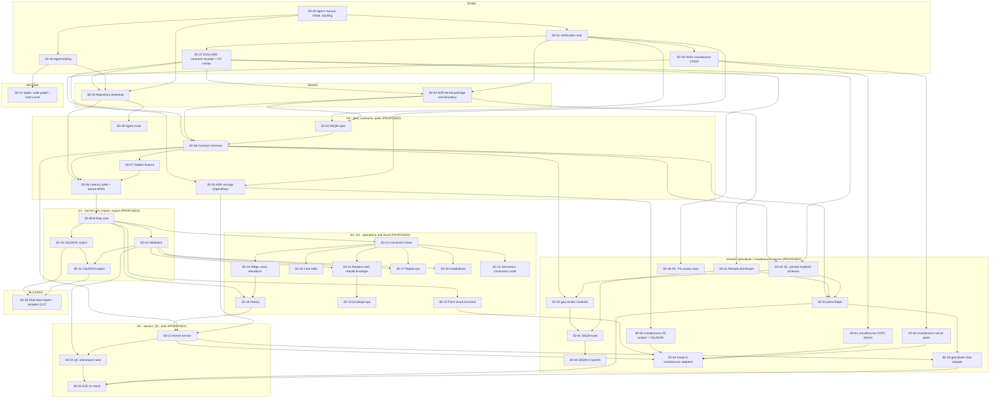

# BACKLOG - 3DQM work packages

New rows enter only through the [`task-intake`](../.claude/skills/task-intake/SKILL.md) skill. Pick the lowest-numbered
`ready` row whose dependencies are `done` ([AGENTS.md §4](../AGENTS.md#4-workflow-for-one-wp)). One WP = one branch =
one session = one PR.

Statuses: `proposed` (intake done, waiting for the owner), `ready` (set by the owner only), `blocked` (reason),
`in-progress` (branch), `review` (PR or local description), `done`, `superseded` (replacing id), `dropped` (reason).
Size: S (< 1 day of agent work), M (up to ~3 days), L (larger; split when it has more than one acceptance group).
Repo: `here` = GeoIPlus/3dEditor; `shared` = GeoIPlus/shared_compnents; `geoviewer`. For `shared`/`geoviewer` rows
this is a mirror (D-23): the row in that repository is authoritative and its id is given in brackets once it exists.
Gate: the v0.3 §13 gate the row serves (G0..G5); gates are traceability only, the process is this backlog.

## Progress overview

Updated: 2026-11-19 (3D-00 accepted D-48; 3D-02, 3D-05, 3D-31 ready D-49, D-50).

| Progress | Rows |
|---|---:|
| Done | 5 / 44 |
| Review | 1 |
| In progress | 0 |
| Ready | 2 |
| Proposed (waiting for the owner to set `ready`) | 35 |
| Blocked (external access or data) | 1 |

**Implementation progress: 0 %** of code; 5/44 rows done. Planning done: agent manual and backlog (3D-00, D-48), verification
notes 3D-01 and 3D-29 ([3D-01](verification/3D-01.md), [3D-29](verification/3D-29.md)), agent tooling 3D-30 (D-47).
**Running:** 3D-02 and 3D-05 (D-49), spike 3D-31 in review (result: defer). **Next:** 3D-28 (agent evals) as soon as 3D-05 is done.

## Work-package status

| WP | Title | Repo | Modules | Depends on | Gate | Size | Status |
|---|---|---|---|---|---|---|---|
| 3D-00 | Agent operating manual, `task-intake` and `wp-session` skills, decisions log, this backlog | here | AGENTS.md, .claude/skills, docs | - | G0 | S | done (D-48) |
| 3D-01 | Verification note: HANDOVER §5-§7 and v0.3 §2 checked against code (shared_compnents = Tools Plane, geoviewer, Operaflow = CP + DP) | here | docs/verification | 00 | G0 | S | done (D-34; merged into base, no PR) |
| 3D-02 | ADR: `geo-model3d` package - internal layout, remote kernel port, relation to `geo-render`/`workspace` (contracts location and P4 check moved to 3D-27) | here | docs/decisions | 01, 27 | G0 | M | ready (D-49) |
| 3D-03 | ADR: storage of building versions, edit journal and results | here | docs/decisions | 01, 29 | G0 | M | proposed (D-35: interim own store behind a port, later crowdsource) |
| 3D-04 | Spec `docs/specs/3dqm-spec.md`: v0.3 in module form, C.8/C.11 in plane terms, golden tests mapped to modules | here | docs/specs | 01, 02 | G0 | L | proposed |
| 3D-05 | Repository bootstrap: npm workspace, Vitest, `tsc --checkJs`, `check:arch` (300 lines, P4 canary + negative control per 3D-ADR-0001), `check:docs`, `backlog:sync`, CI | here | root, tools | 00, 27 | G0 | M | ready (D-49) |
| 3D-06 | Contract schemas `model3d`: model, commands (all `OperationKind`), patch, lineage, validation report, error registry, tolerance profile | here (D-37) | contracts | 04, 27 | G0 | L | proposed |
| 3D-07 | Golden fixtures: format and synthetic CityJSON/point sets for GT-I1..GT-25 | here | fixtures | 06 | G0 | M | proposed |
| 3D-08 | Latency spike: prototype `MOVE_EDGE` on GT-03, p95; ADRs kernel language/Boolean (ADR-001), solver (ADR-S), bench rig (ADR-012) | here | geo-model3d (spike), docs | 05, 06, 07 | G0 | M | proposed |
| 3D-09 | Kernel core: half-edge B-Rep, primary planes, derived vertices, local frame, transactions, versions | here | geo-model3d/brep | 08 | G1 | L | proposed |
| 3D-10 | Import I-01: CityJSON -> canonical model + RTG + baseline | here | geo-model3d/import | 09 | G1 | L | proposed |
| 3D-11 | Export: canonical model -> CityJSON, opaque data round-trip | here | geo-model3d/export | 10, 12 | G1 | M | proposed |
| 3D-12 | Validation: FAST_PREVIEW, COMMIT_VALIDATION, FINAL_VALIDATION (val3dity), severity by state | here | geo-model3d/validate | 09 | G1 | L | proposed |
| 3D-13 | Constraint solver and conflict diagnostics | here | geo-model3d/solve | 09 | G3 | L | proposed |
| 3D-14 | `REPLACE_ROOF` R-01..R-04, `REBUILD_ENVELOPE` | here | geo-model3d/ops | 12, 13 | G2 | L | proposed |
| 3D-15 | Core edits: `MOVE_VERTEX`, `MOVE_EDGE`, `OFFSET_FACE`, `SPLIT_FACE`, `INSERT_ROOF_BREAK`, `MERGE_FACES`, `REMOVE_DETAILS`, `STRAIGHTEN_FACE`, `TRIM_FACE`, `EXTEND_FACE` | here | geo-model3d/ops | 13 | G3 | L | proposed |
| 3D-16 | `ALIGN_RIDGE`, `ALIGN_EAVE`, `MATCH_ELEVATIONS` | here | geo-model3d/ops | 13 | G3 | M | proposed |
| 3D-17 | Repair: `REMOVE_FACE`, `HEAL_HOLE`, `FIT_TO_SHARED_EDGE`, `ALIGN_JUNCTION` | here | geo-model3d/ops | 12, 13 | G3/G4 | L | proposed |
| 3D-18 | History: `UNDO`, `REDO`, `RESTORE_BASELINE`, idempotent `commandId`, `expectedVersion` | here | geo-model3d | 09, 16 | G3 | M | proposed |
| 3D-19 | Envelope: `RESIZE_ROOF`, `SET_OVERHANG`, `REGULARIZE_FOOTPRINT`, `ALIGN_WALL`, `SET_HEIGHT`, `TRANSLATE_BUILDING`, `ROTATE_BUILDING` | here | geo-model3d/ops | 14 | G4 | L | proposed |
| 3D-20 | Installations: `ADD_DORMER`, `ADD_CHIMNEY`, `REMOVE_INSTALLATION`; limited Boolean (v0.3 §14, K-12) | here | geo-model3d/ops | 12, 13 | G4 | L | proposed |
| 3D-21 | `SET_SEMANTICS`, `SET_CONSTRAINT`, `REMOVE_CONSTRAINT` | here | geo-model3d/ops | 13 | G3 | S | proposed |
| 3D-22 | Point cloud: point port (box query) with interim adapter reading COPC by box / LAS whole (D-35), `FIT_PLANE` (RANSAC + SVD), deviation heatmap | here | geo-model3d/cloud | 09 | G4 | M | proposed |
| 3D-23 | Kernel service: command API PREVIEW/COMMIT/`previewId`, rate limit, error registry, command status, storage port with interim file/S3 adapter (D-35) | here | service | 03, 06, 18 | G5 | L | proposed |
| 3D-24 | QC and export rules: state transitions, approver != author (enforced by 3DQM: the Operaflow format has no separation-of-duties rule), reset on edit, export gate, batch export report | here | geo-model3d, service | 12, 23 | G5 | M | proposed |
| 3D-25 | E2E on CP/DP mock: import -> edit -> validate -> approve -> export -> re-import | here | e2e | 24, 43, 50 | G5 | M | proposed |
| 3D-26 | Import acceptance on real roofer and TerraSolid output; tolerance profile calibration | here | geo-model3d/import, fixtures | 10, 11 | G1 | M | blocked (sample data path, Q-07) |
| 3D-27 | Early ADR: location of `model3d` contract schemas (Q-08) and P4 canary check of client bundles (Q-09) | here | docs/decisions | 01 | G0 | S | done (D-39; merged into base, no PR) |
| 3D-29 | Verify `GeoIPlus/crowdsource` as the CP/DP implementation: data serving, storage, versions, point-cloud forms, auth, deployment | here | docs/verification | 01 | G0 | S | done (D-36; merged into base, no PR) |
| 3D-30 | Agent tooling: `merge-wp` skill, `tools/check-docs.mjs` + Stop hook, `docs/source` edit guard, read-only permission allow list | here | .claude, tools | 00 | G0 | S | done (D-47; merged into base, no PR) |
| 3D-28 | Agent evals: 6-8 golden agent tasks + one per hard rule, rubric, runner, two runs each, baseline in DECISIONS | here | docs/agent-evals | 05 | G0 | M | proposed |
| 3D-31 | Spike: codebase graph / read-cache tool (MCP or skill) measured on cross-repo reading tasks, with vs. without | here | .claude, docs/agent-evals | 30 | G0 | M | review (wp/3d-31-code-graph-spike; local, PR not requested; result: defer, [eval](agent-evals/3D-31-code-graph.md)) |
| 3D-60 | crowdsource: 3D project type and CityJSON building dataset kind (Operaflow-conformant) | crowdsource | backend, streaming | 03, 29 | G5+ | L | proposed (D-35; under crowdsource's own process) |
| 3D-61 | crowdsource: point clouds as COPC `stream` datasets (box reads by the client of the stream) | crowdsource | streaming | 29 | G5+ | M | proposed (D-35) |
| 3D-62 | crowdsource: client-credentials (server-to-server) grant for supporting-application services | crowdsource | backend, auth | 29 | G5+ | M | proposed (D-35) |
| 3D-63 | Swap 3DQM interim data adapters for crowdsource datasets; migrate stored buildings and journals | here | service, geo-model3d/cloud | 22, 23, 60, 61, 62 | G5+ | M | proposed (D-35) |
| 3D-40 | `geo-render/model3d`: draw edited building from patches, hide source layer, ghost, pick by entity id | shared | geo-render | 06, 45; shared WP-19, WP-20 | G3 | L | proposed (Q-12 answered by 3D-01: no 3D scene in `geo-render`; 3D-02 decides scene source (Q-16), row may split; UI per brandbook, D-40) |
| 3D-41 | Remote kernel port in `workspace/plan` (network port described by schema) | shared | workspace/plan | 02; shared WP-21 | G3 | M | proposed (Q-13 narrowed by 3D-01: `placement: dp` declarable, not executed) |
| 3D-42 | 3DQM tools: E-04 state machine, selection, snapping incl. point cloud, numeric input, PREVIEW throttling | shared | workspace/tools | 40, 41; shared WP-24 | G3 | L | proposed (UI per brandbook, D-40) |
| 3D-43 | `plans/3dqm`: `production` and `qa` plans, 3DQM contract extension schema | shared | plans, contracts | 06, 41, 45; shared WP-21, WP-28 | G5 | M | proposed (Q-03 shape known, 3D-01 §6; extension URI content-named, no product) |
| 3D-44 | 3DQM UI panels: validation issues, constraint inspector, heatmap legend, QC approve/return | shared | workspace/ui | 42; shared WP-23, WP-25 | G4/G5 | M | proposed (UI per brandbook, D-40) |
| 3D-45 | Pinned `model3d` schemas in `shared_compnents`: `contracts/vendor/3deditor/` + `provenance.json` hash check; how client code loads them | shared | contracts | 06, 27 | G3 | S | proposed (D-37) |
| 3D-46 | P4 canary scan of `shared_compnents` browser outputs + rule "no `geo-model3d` dependency" | shared | tools, CI | 27 | G0 | S | proposed (D-37) |
| 3D-50 | geoviewer host adapter: add `@geoiplus/*` dependencies (none today), mount workplace, kernel route on server, file storage port for tests, P4 canary scan of the client build | geoviewer | host | 23, 43 | G5 | M | proposed (UI per brandbook, D-40) |

## Details

### 3D-00 Agent operating manual and backlog
- Source: owner message 2026-11-19. Goal: rules for agent sessions, documentation, handoffs and intake.
- Accept: AGENTS.md, CLAUDE.md, STRUCTURE.md, skills `task-intake` and `wp-session`, templates, DECISIONS.md with
  D-01..D-27 and Q-01..Q-13, this backlog; owner questions asked as dialog and recorded.

### 3D-01 Verification note
- Goal: each [V]/[A] item of HANDOVER §5-§7 and v0.3 §2 checked against code with file references; corrections listed.
- Accept: `docs/verification/3D-01.md`; every item marked confirmed / corrected / not checkable (why); Q-12, Q-13
  answered or narrowed; how geoviewer consumes `@geoiplus/*` recorded; Operaflow (CP, D-29): workplace contract
  shape, assignment/roles, data/storage and point-cloud access (narrows Q-02..Q-05); list of Operaflow conformance
  requirements for the kernel service (Q-15, D-31). Read-only in other repositories.

### 3D-02 ADR kernel package and boundary
- Accept: `3D-ADR-0002` answers Q-13 and HANDOVER §7 Q2 (remote port), the internal package layout and the relation
  to `geo-render`/`workspace`, with options and a recommendation; owner-approved (D-18). Builds on 3D-27.

### 3D-03 ADR storage
- Accept: `3D-ADR-0003` proposes one option for versions, journal, baseline and results after reading CP/DP code;
  retention >= 90 days (v0.3 §11) addressed; conforms to Operaflow (D-31, Q-15).
- 3D-01 input: Operaflow holds no storage. Dataset `version`, `PUT` + `If-Match` / OGC API Features saves and immutable
  deliveries are in the format; the journal, drafts and retention are 3DQM's own ([verification §9](verification/3D-01.md#9-operaflow-as-cp--dp-data-point-clouds-conformance-d-30-d-31-q-15)).

### 3D-04 3DQM spec
- Accept: one section per module (purpose, API, rules, `Accept:` lines); contracts as a list of schemas; C.8 and C.11
  restated in plane terms (D-08); each golden test of v0.3 §12 assigned to one module and one row; v0.3 process text
  (gates, agent template) dropped; admin functions removed (D-10). Owner reviews before 3D-06 starts.

### 3D-05 Repository bootstrap
- Accept: `npm ci && npm run check` pass on the empty skeleton; a planted client-side import of `geo-model3d`, a 301-line
  file, a DOM global in the kernel and the P4 canary planted in a test bundle each fail `check:arch` (tests for the
  checker). Per [3D-ADR-0001](decisions/adr/3D-ADR-0001-contracts-location-and-p4-canary.md) (D-37): the canary value
  is generated once; `check:arch` fails if an `exports` entry of `geo-model3d` does not import the canary module; the
  negative control (minified Vite browser build of each entry) finds the marker in every output, else CI fails. `check:docs` fails on a planted count mismatch, a graph node without a row, a duplicate D/Q id, a dead link
  and a row without `Accept:`. `backlog:sync` reads a pinned ref of the other BACKLOG (fixture in tests, no network)
  and CI fails on drift (D-25). `check:docs` also rejects provisional decision ids `D-3D<wp>-<n>` on the base (D-38). Commands of AGENTS.md §5 exist.

### 3D-06 Contract schemas
- Accept: JSON Schema 2020-12 for every `OperationKind` payload (v0.3 §9.1), result, patch, `topologyLineage`
  `{mapped, deleted, preserved}`, validation report, error registry (v0.3 §9.2), tolerance profile (D-13 values as
  defaults); valid and invalid examples per schema; Ajv 2020 compiles all. Owner-approved (D-18). Location
  `contracts/model3d/` here; every `$id` matches `urn:geoiplus:schema:model3d-<name>:v<n>` (D-37, 3D-ADR-0001). L: split by intake if
  the command schemas and the model schemas review separately.

### 3D-07 Golden fixtures
- Accept: fixture format recorded; inputs for GT-I1..GT-I4, GT-01..GT-25 generated by a script, byte-identical on
  regeneration; expected values copied from v0.3 §12 with the checks of its last paragraph reproduced in a test.

### 3D-08 Latency spike and kernel ADRs
- Accept: prototype `MOVE_EDGE` on GT-03 in the chosen language; p95 server PREVIEW for a 200-face building measured on
  the recorded rig; result vs. 150 ms target. If it fails: escalate to the owner (D-06), no client fallback. ADRs for
  kernel language/Boolean library and licences (closes Q-01) and solver approach, owner-approved.

### 3D-09 .. 3D-24 Kernel, operations, service
- Accept lines come from `docs/specs/3dqm-spec.md` (3D-04). Golden tests per row:
  3D-09 GT-25; 3D-10 GT-I1..GT-I3; 3D-11 GT-I4; 3D-14 GT-01..GT-05; 3D-15 GT-08, GT-10; 3D-16 GT-07, GT-09;
  3D-17 GT-06, GT-11, GT-19; 3D-18 GT-12, GT-13; 3D-19 GT-14..GT-16; 3D-20 GT-17, GT-18; 3D-22 GT-20, GT-21;
  3D-24 GT-22, GT-24 (GT-23 is enforced from the CP contract, D-10: test belongs to 3D-25).
- Every operation: atomic commit, PREVIEW before COMMIT, hard-constraint conflict -> refusal without partial change,
  lineage in the result, "commit adds no new errors for the current state" (v0.3 §6).

### 3D-25 E2E
- Accept: the v0.3 G5 E2E chain on the CP/DP mock in both workplaces; GT-23 (building outside assignment -> 403).

### 3D-26 Real-data import
- Accept: import + export round-trip of the owner's roofer and TerraSolid samples; tolerance profile adjustments
  proposed as decisions, not edited silently. Binaries stay outside git unless the owner allows.

### 3D-27 Early ADR: contracts location and P4 canary
- Source: owner dialog 2026-11-19 (D-24). Goal: close the repository seam before contracts and bootstrap start.
- Accept: `3D-ADR-0001` closes Q-08 (one authoritative location of `model3d` schemas, how the other repository
  consumes them at a pinned version) and Q-09 (canary marker format, which bundles CI scans in each repository);
  owner-approved (D-18). Reads `shared_compnents` contracts/build setup; read-only there.

### 3D-29 Verify crowdsource as CP/DP implementation
- Source: owner dialog 2026-11-19 (D-32). Goal: replace the assumption "Operaflow = DP" by facts.
- Accept: `docs/verification/3D-29.md` with `crowdsource` revision and file:line references: what CP/DP roles it
  implements, how it serves datasets (forms, `stream`/COPC, box reads), where versions/results/journals live, auth,
  deployment; Q-02, Q-05, Q-14 narrowed; D-32 confirmed or corrected. Read-only in `crowdsource`.

### 3D-30 Agent tooling (D-46)
- Source: claude-code-setup analysis, owner dialog 2026-11-19. Goal: cut repeated coordinator work and ad-hoc checks.
- Accept: (1) `.claude/skills/merge-wp/SKILL.md`: ancestry check, merge, provisional ids `D-3D<wp>-n` -> final `D-NN`
  with all references rewritten, backlog recount, branch delete attempt, session archive (D-38, D-42).
  (2) `tools/check-docs.mjs` (Node, no deps): overview counts = table, mermaid nodes = rows, unique D/Q ids in the
  decision table, no provisional ids, relative links resolve, every row has an Accept line or a Details entry; exit 1
  with one line per problem; tests on planted faults in `tools/check-docs.test.mjs` runnable with `node --test`.
  (3) `.claude/settings.json`: Stop hook runs the script only when `docs/` changed (quiet on success); PreToolUse hook
  refuses Edit/Write under `docs/source/`; allow list for read-only git/grep. (4) Each hook demonstrated once with output.
  3D-05 later folds the script into `npm run check`.

### 3D-28 Agent evals
- Source: owner dialog 2026-11-19 (D-27). Goal: prove the instructions by measurement.
- Accept: `docs/agent-evals/<task>/` with prompt, start state, rubric graded on the final result; tasks at least:
  intake of a new request, chore vs. non-chore, refuse a client import of the kernel, mark an unknown tolerance
  `TBD`, refuse to re-open a decision, handoff to a fresh session, question asked as a dialog; plus one per hard rule
  of AGENTS.md §2. Every task run twice; scores recorded in DECISIONS.md. A rule change is kept only if evals hold.

### 3D-31 Spike: codebase graph / read-cache tool (D-50)
- Source: owner message 2026-11-19 (Codebase Memory MCP and similar graph/cache tools against repeated code reading).
- Goal: decide with measured data whether one local code-graph or read-cache tool lowers cost per task without lowering
  result quality.
- Scope in: check which candidate tools exist and what they need (codebase-memory-mcp first; others only if their
  repository is found); pick one that runs fully locally (no code sent to external services); install it for the
  session only; one fixed cross-repo reading task on code that exists (`GeoIPlus/shared_compnents` and/or `geoviewer`,
  e.g. "where would the remote kernel port plug in, what does it touch"), run twice with and twice without the tool.
  Scope out: permanent install in `.claude/settings.json` or the environment setup script (needs a new owner decision),
  indexing `docs/source` (markdown, not code), more than one tool per run.
- Accept: `docs/agent-evals/3D-31-code-graph.md` with tool name, version, install steps actually run, the task text,
  a rubric, and per run: cost, context tokens, tool calls, turns, rubric score; tool-definition count added; a
  recommendation (adopt / defer until kernel code exists / reject) that follows from the numbers; noise stated
  (n=2 per arm). Vendor claims are cited as claims, not results.
- Decisions: D-43, D-50  Open: -

### 3D-60 .. 3D-63 Data serving in crowdsource (D-35)
- Source: owner dialog 2026-11-19 after 3D-29. 3D-60..3D-62 are added in `crowdsource` by a session working there under
  its rules; this backlog mirrors them (D-25). 3D-63 is the 3DQM side of the move.
- Accept 3D-63: same golden tests pass against crowdsource adapters as against the interim adapters; no change to
  kernel code outside adapters; stored building versions and journals migrated with a recorded check.

### 3D-45, 3D-46 shared_compnents mirrors from 3D-27 (class `external`; D-37, [3D-ADR-0001](decisions/adr/3D-ADR-0001-contracts-location-and-p4-canary.md))
- 3D-45 Accept: SC vendors the schemas into `contracts/vendor/3deditor/` + `provenance.json`; an edited copy fails SC
  `npm run check`; a `revision` bump passes; the loading module is named (`sync-contract-assets.js:11` skips vendor/).
- 3D-46 Accept: SC CI scans its browser outputs (ADR table "what each repository scans") for the canary pattern and
  rejects a `geo-model3d` dependency; a planted synthetic marker per output kind and a planted dependency each fail.

### 3D-40 .. 3D-50 Mirrors
- UI rows (3D-40, 3D-42, 3D-44, 3D-50) follow `GeoIPlus/brandbook` (D-40); acceptance includes the brand checks of the
  repository they are built in.
- Rows are added in the other repository by a session working there, under its AGENTS.md; this row records the id
  and status. 3D-40 depends on Q-12; 3D-41 on Q-13; 3D-43 on Q-03.
- 3D-01 changes (intake `change-wp`, 2026-11-19; [verification note](verification/3D-01.md)):
  - 3D-40: `geo-render` has only a 2D orthographic host and XY picking; geoviewer `scene3d` picks points, not entity ids.
    The 3D scene source (new `geo-render` module vs geoviewer host port) is decided in 3D-02; split 3D-40 if it grows.
- 3D-27 (`change-wp`, D-37): 3D-40/3D-43 depend on 3D-45. 3D-50 also scans GV `client/dist` (+ `.map`) for the canary; a planted marker fails it.
  - 3D-41: Accept adds "a plan placement value or binding that a remote (Tools Plane) kernel port can use; WP-28's
    compose executes it" - today `placement` (`dp`, `dp.batch`) is declarative only.
  - 3D-43: the extension follows `extension-orthoqm.schema.json` (assignment, dataset, production, runtime,
    deliverable) under a content-named URI (Operaflow `extension-names-no-product`); buildings as `work.units`.
  - 3D-50: geoviewer consumes no `@geoiplus/*` package today; Accept adds the registry token in its CI and Docker build.
